# Cine Aurora | Plataforma de cine full stack

**De elegir una película a validar el ingreso a la sala: una experiencia conectada
para espectadores, empleados y administradores.**

Aplicación web responsive y progresiva que reúne venta de entradas, selección de
butacas, productos de candy y gestión de un cine de varias salas. Un proyecto de
portafolio de origen académico que conecta interfaz, autenticación, reglas de
negocio en PostgreSQL y despliegue web.

**[Explorar la demo →](https://cine-aurora.vercel.app)** ·
[Ver funcionalidades](#funcionalidades) ·
[Ver la experiencia del cliente](#experiencia-del-cliente) ·
[Ver el backoffice](#backoffice-administración-de-punta-a-punta) ·
[Ver capturas](#capturas-de-pantalla) ·
[Revisar arquitectura](#arquitectura) ·
[Ejecutar localmente](#instalación-local)

`Angular 22` · `TypeScript` · `Supabase` · `PostgreSQL` · `PWA` · `Vitest`

> **Pago simulado:** no se cobra dinero real ni se integra una pasarela de pago.
> La demo es un entorno de presentación, no un servicio comercial.

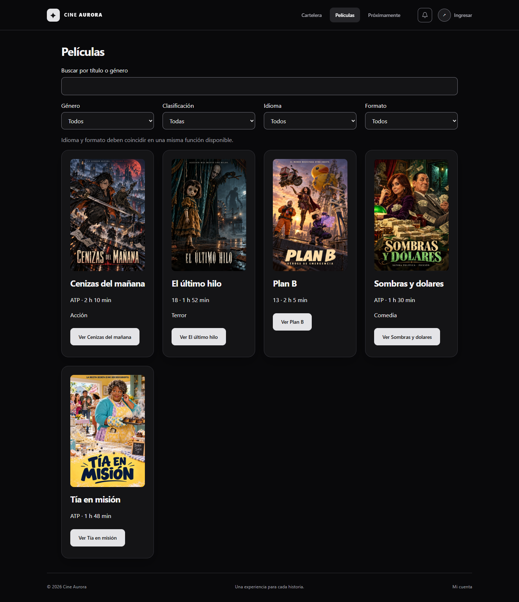

## El proyecto en un minuto

- **Para el espectador:** descubrir películas, elegir función y butacas, sumar
  candy y obtener un comprobante digital con QR.
- **Para el cine:** organizar salas y horarios, gestionar promociones, validar
  prestaciones y consultar ventas desde un backoffice por roles.
- **Más allá de un CRUD:** disponibilidad en vivo, reservas temporales,
  validación de descuentos en servidor, idempotencia y operaciones atómicas.
- **En el código:** frontend organizado por funcionalidades, backend SQL con
  RPC/RLS, Edge Functions y pruebas de interfaz y reglas de negocio.

## Experiencia del cliente

**Descubrir, elegir y volver.** El recorrido conecta la cartelera con la compra
y una cuenta donde consultar actividad y beneficios. La misma aplicación se
adapta a escritorio y móvil.

Todas las imágenes de esta presentación son **capturas de página completa**:
incluyen la cabecera, el contenido y el pie, sin recortar formularios ni listados.
Se pueden abrir en tamaño original haciendo clic en ellas. Los estados vacíos
son los reales de la cuenta utilizada, no datos inventados para la presentación.

<details>
<summary><strong>01 · Descubrimiento — inicio, catálogo, estrenos y ficha de película</strong></summary>

### Inicio

Ranking de ventas, selección de películas y accesos a funciones y al club de beneficios.

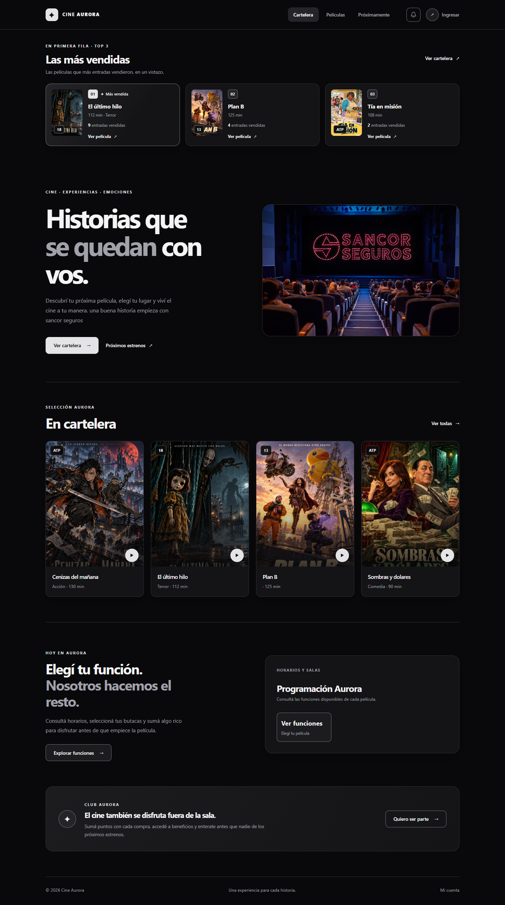

### Películas

Búsqueda por título o género, clasificación, idioma y formato. Idioma y formato
deben coincidir en una misma función disponible.


### Próximos estrenos

Separación automática entre cartelera y próximos estrenos según la fecha civil argentina.

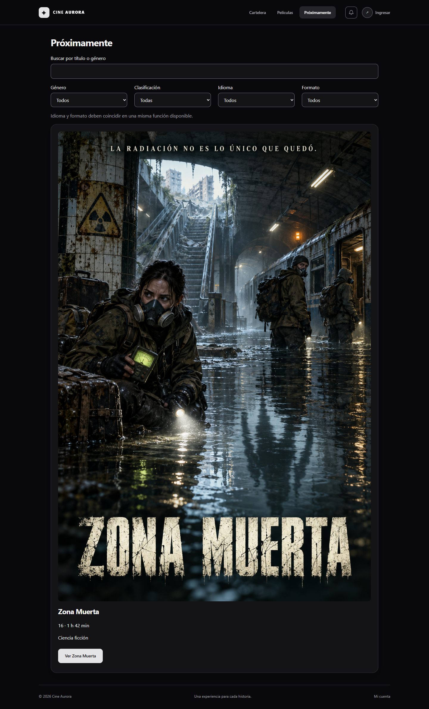

### Detalle de película

Sinopsis, clasificación, duración, funciones disponibles y reseñas en una misma ficha.

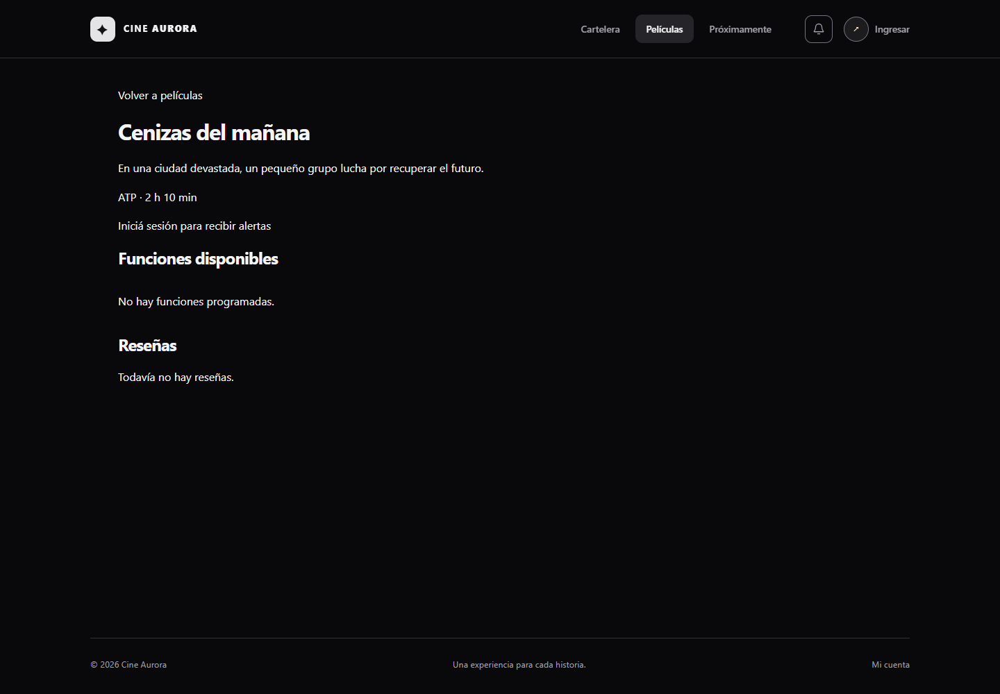

</details>

<details>
<summary><strong>02 · Cuenta — perfil, compras y películas vistas</strong></summary>

### Acceso y registro

Inicio de sesión y alta de cuenta para acceder al historial y a los beneficios.
La recuperación de contraseña forma parte del mismo módulo de autenticación.

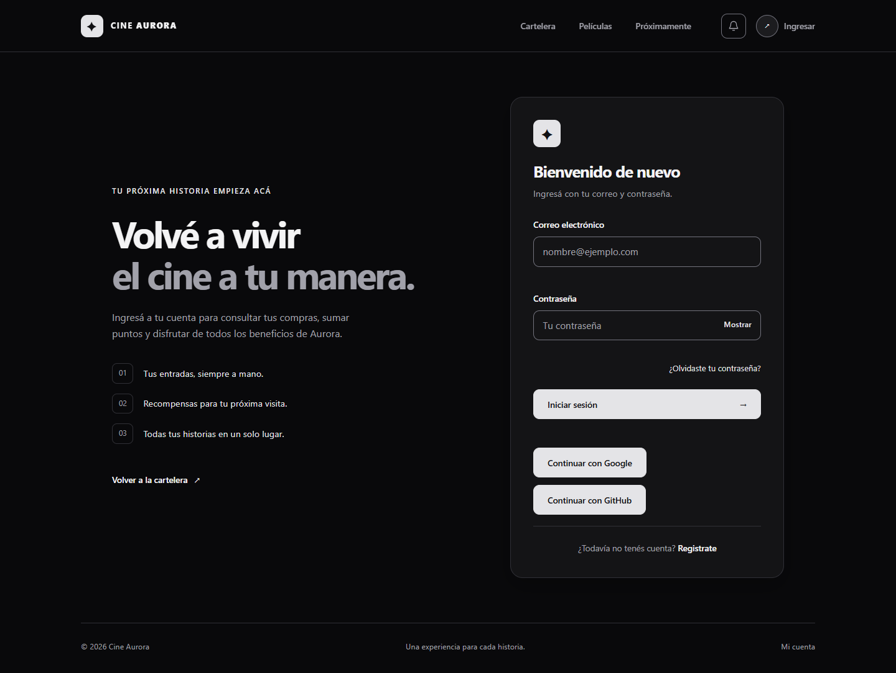

### Mi perfil

Datos de la cuenta, preferencias y accesos al historial y a los beneficios.
Los valores personales del formulario están ocultos únicamente en la captura.

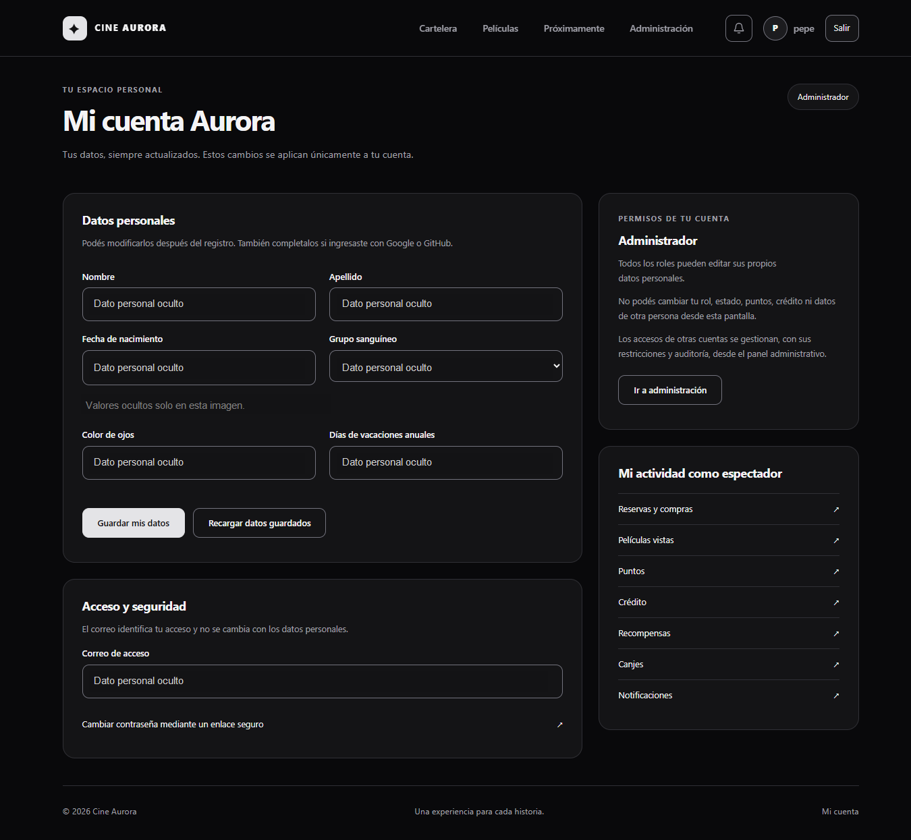

### Mis compras

Historial personal y acceso al detalle de cada compra. Desde una compra elegible
se puede consultar su comprobante y realizar las acciones permitidas por las reglas.

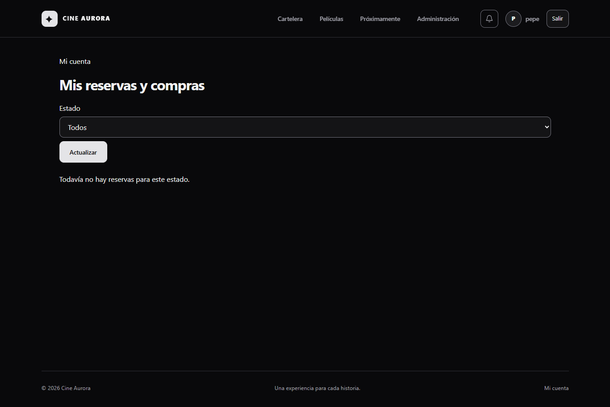

### Películas vistas

El historial de asistencia distingue una compra de una entrada utilizada. Las
reseñas se habilitan a partir de una compra confirmada con ingreso registrado.

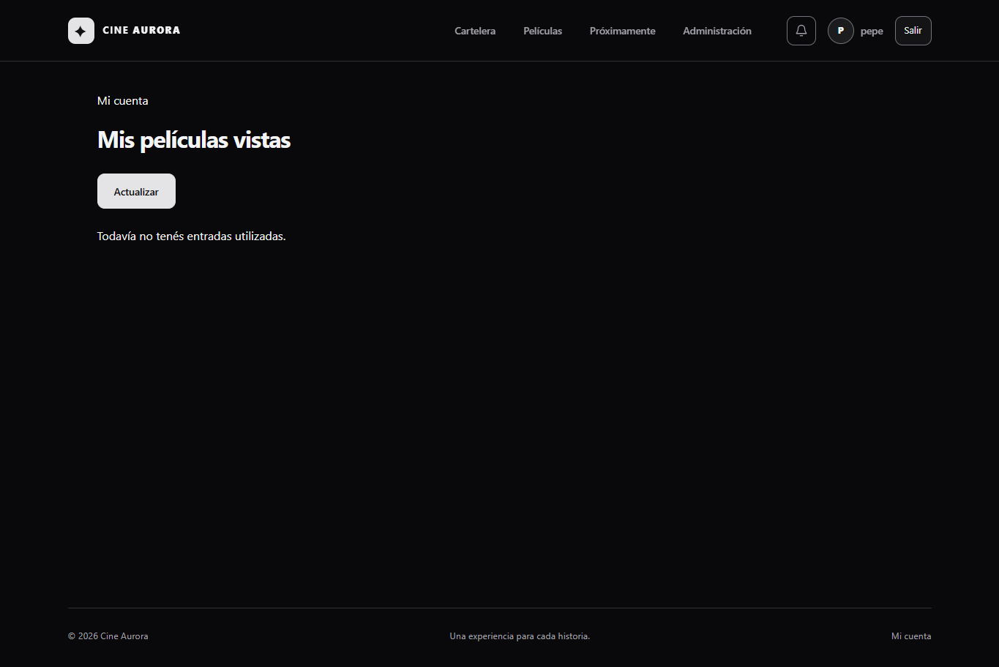

</details>

<details>
<summary><strong>03 · Fidelización — puntos, recompensas, canjes y crédito</strong></summary>

### Puntos

Consulta del saldo y movimientos del programa de fidelización.

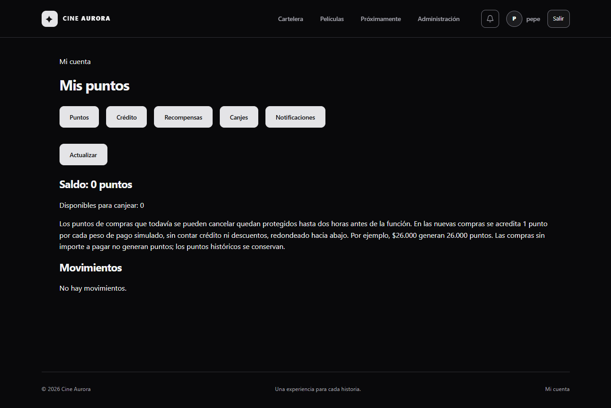

### Recompensas

Catálogo de beneficios canjeables por puntos, con sus condiciones y costo de canje.

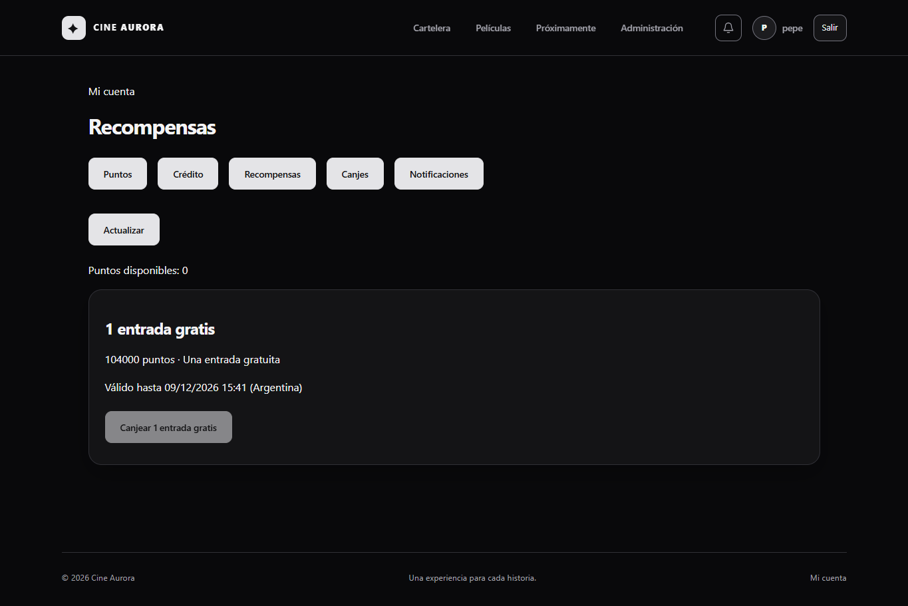

### Mis canjes

Consulta de los beneficios obtenidos y de su estado.

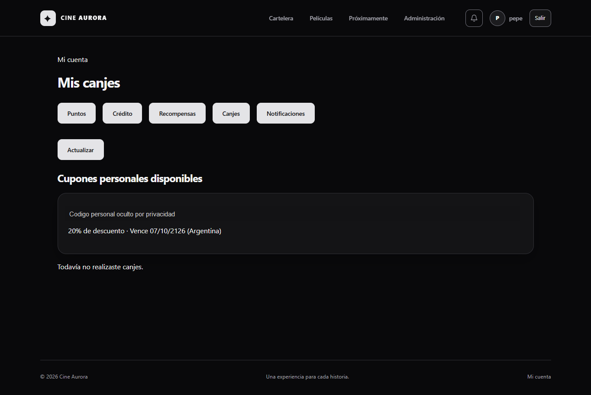

### Crédito

Consulta del crédito disponible y su historial de movimientos; el servidor
valida el saldo al aplicarlo en una compra.

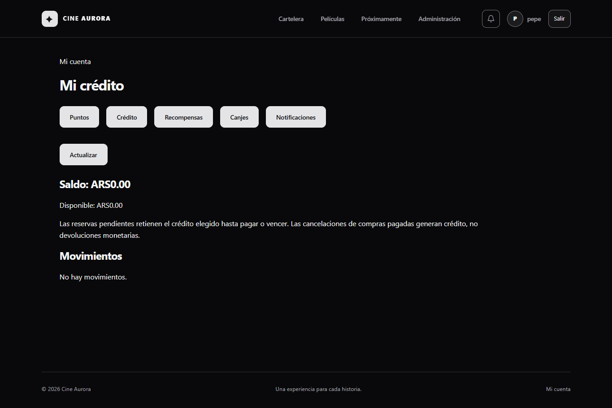

</details>

<details>
<summary><strong>04 · Notificaciones y experiencia móvil</strong></summary>

### Notificaciones

Centro de avisos y preferencias de notificaciones. La recepción Web Push real
en un dispositivo continúa siendo una verificación pendiente.

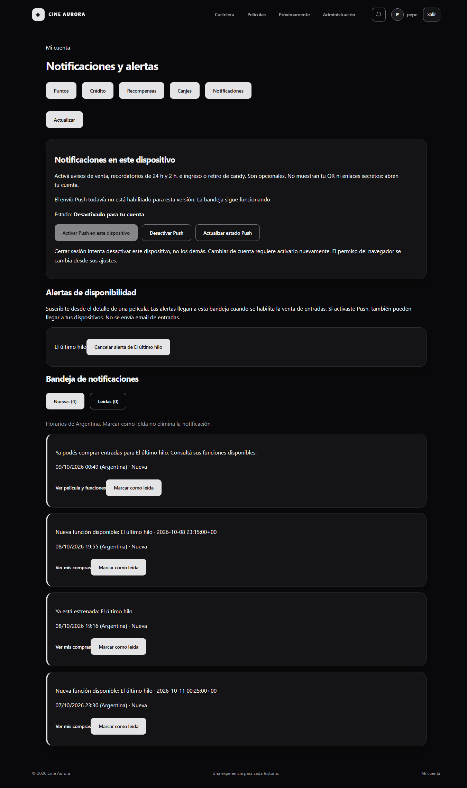

### Móvil

Navegación, filtros y tarjetas reorganizados para una pantalla pequeña. La
imagen incluye **todo el catálogo móvil**, no solo la primera pantalla visible.

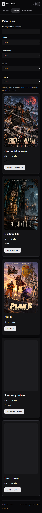

</details>

**Compra guiada:** película y función → butacas → candy → checkout → comprobante
PDF/QR. La compra requiere funciones futuras disponibles. Como no las había al
tomar las capturas, esta galería no incluye butacas de compra, checkout ni un
comprobante nuevo. El recorrido y sus validaciones se describen en
[Flujo principal](#flujo-principal).

## Backoffice: administración de punta a punta

**Aurora Studio es el centro de operación del cine**, no solo un formulario para
cargar películas. La vista general reúne indicadores de los últimos siete días,
búsqueda de herramientas y accesos a seis áreas de gestión.

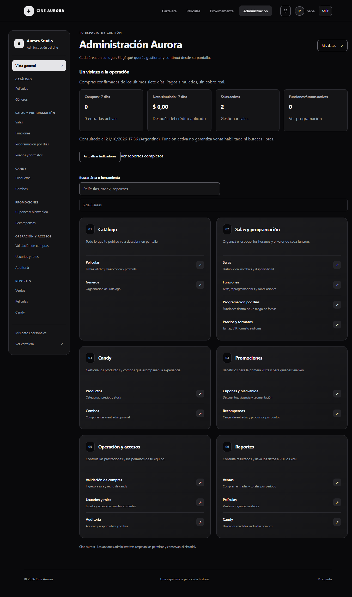

| Área | Herramientas disponibles |
| --- | --- |
| **Catálogo** | Películas, afiches, clasificación, preventa, géneros, búsqueda y gestión de registros activos e históricos. |
| **Salas y programación** | Salas, mantenimiento de butacas, funciones, programación por días y rango, precios, recargo VIP, idioma y formato. |
| **Candy** | Productos, categorías, precios, stock y combos con componentes y entrada opcional. |
| **Promociones** | Cupones, porcentaje de bienvenida y recompensas canjeables por puntos. |
| **Operación y accesos** | Validación de entrada o candy, administración de usuarios y roles, y consulta de auditoría. |
| **Reportes** | Ventas, películas y candy por período, indicadores, rankings, gráficos y exportación a Excel/PDF. |

### Recorrido visual del administrador

**Desplegá cada área para ver sus pantallas y responsabilidades.** Las capturas
del backoffice y de la cuenta se tomaron en la aplicación local, con una sesión
autorizada, el **21 de octubre de 2026**. No son maquetas. Los datos personales
y códigos privados se ocultan sobre las imágenes antes de publicarlas; no se
publican contraseñas ni tokens. Los importes son de compras simuladas.

<details>
<summary><strong>01 · Catálogo — películas y géneros</strong></summary>

#### Películas

Alta y edición de fichas, afiches, duración, clasificación y preventa. El listado
incluye búsqueda y filtro de registros; la baja lógica conserva la historia en
lugar de borrar las compras asociadas.

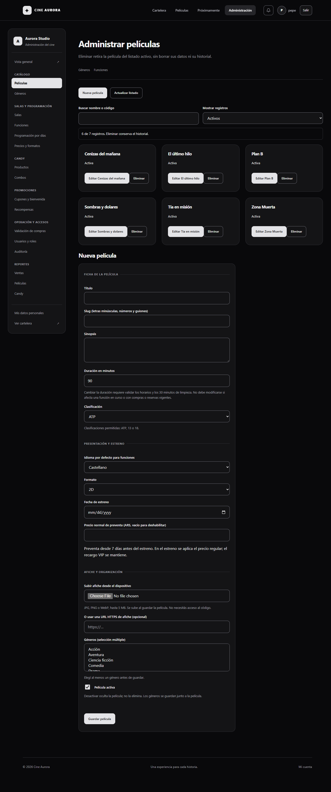

#### Géneros

Organización del catálogo mediante nombre, slug y estado, con búsqueda y gestión
de registros. Estos géneros se utilizan en el descubrimiento público de películas.

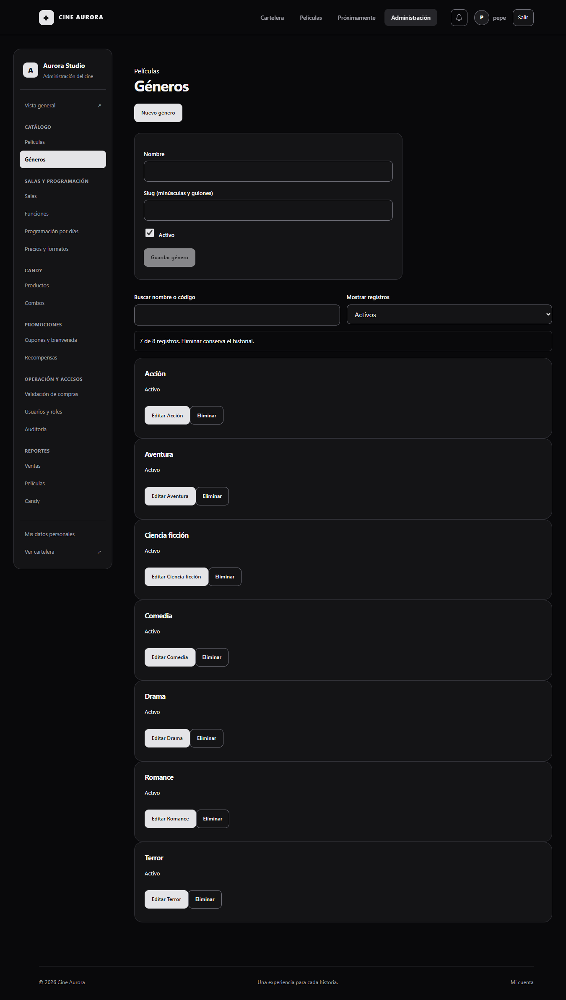

</details>

<details>
<summary><strong>02 · Salas y programación — espacios, butacas, funciones y precios</strong></summary>

#### Salas

Configuración de los espacios del cine, nombres y distribución. El plano
documentado distingue butacas normales, accesibles y VIP; las salas con historia
se desactivan para conservar sus registros.

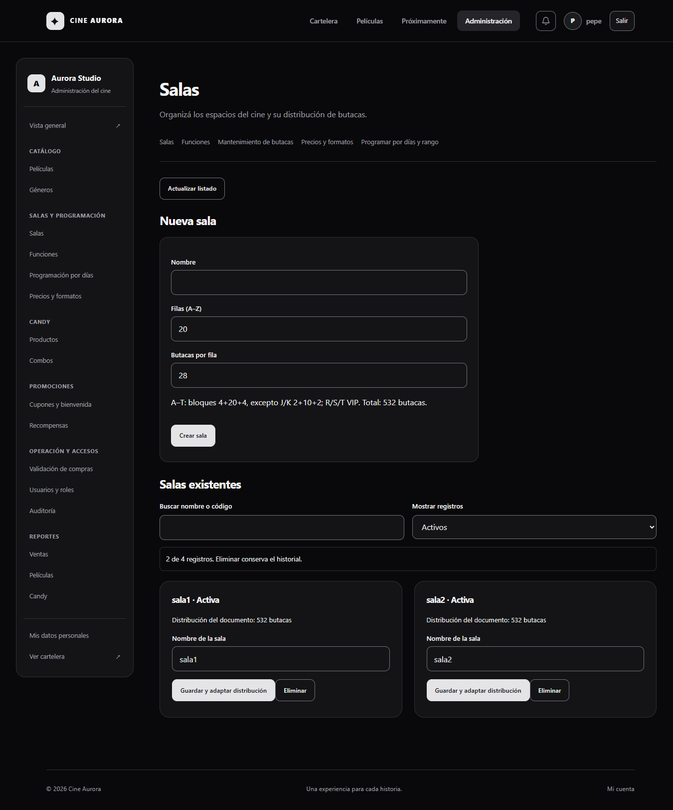

#### Mantenimiento de butacas

Consulta del plano por sala y bloqueo/restauración de asientos con motivo
obligatorio. El mantenimiento afecta las funciones de esa sala, queda auditado
y no permite bloquear butacas protegidas por compras o reservas vigentes.
La captura incluye la página completa del editor. El plano conserva el
desplazamiento horizontal propio de la interfaz; no se modificó ningún asiento.

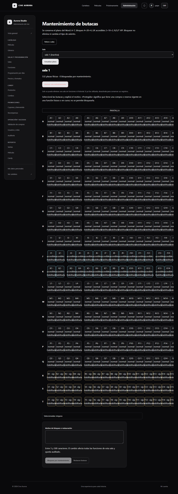

#### Funciones

Creación y gestión de horarios. La sala disponible se asigna automáticamente
respetando duración y limpieza entre funciones; el servidor controla los
solapamientos. También se contemplan reprogramación y cancelación según sus reglas.

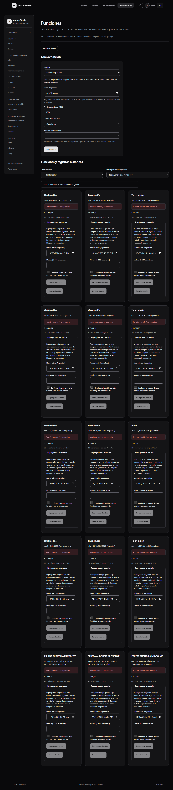

#### Programación por días y rango

Programación repetida dentro de un intervalo: película, fecha inicial/final,
hora argentina y días de la semana. Evita cargar cada función manualmente.

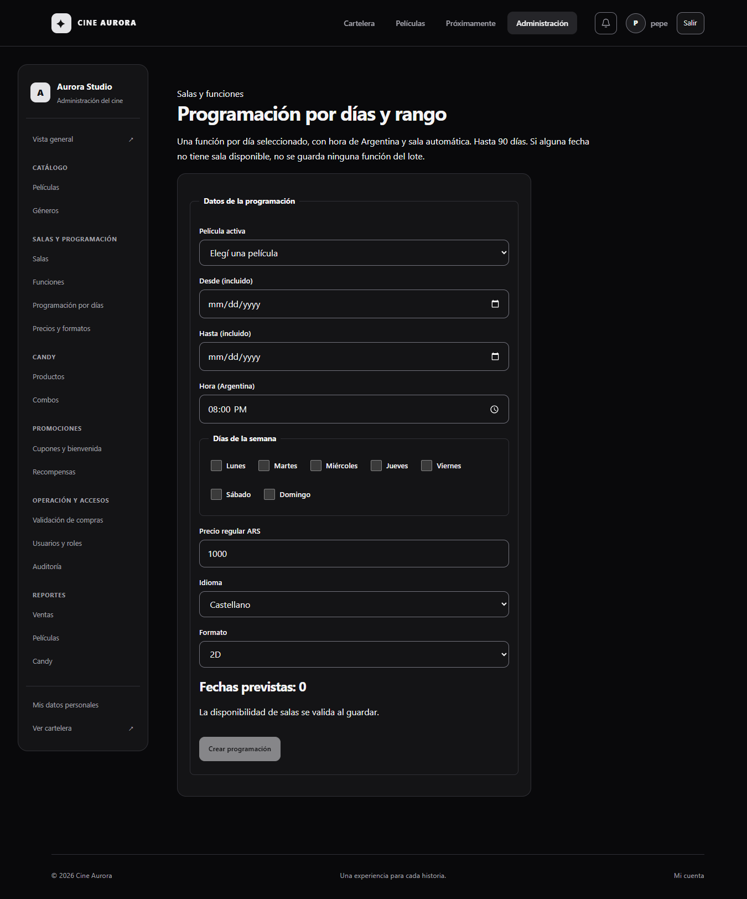

#### Precios y formatos

Consulta y edición de tarifa, recargo VIP, idioma y formato. Los filtros por sala
y estado operativo distinguen funciones futuras de registros históricos.

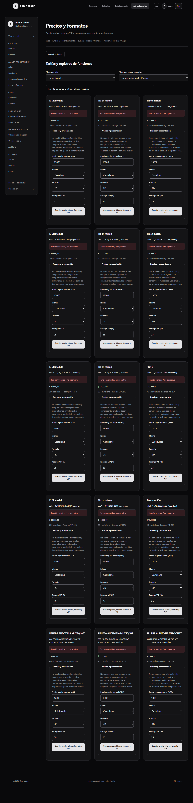

</details>

<details>
<summary><strong>03 · Candy — productos, stock y combos</strong></summary>

#### Productos

Gestión de categorías, precios, imágenes y stock. El inventario se vuelve a
validar en servidor durante la compra, no solo al agregar un producto al carrito.

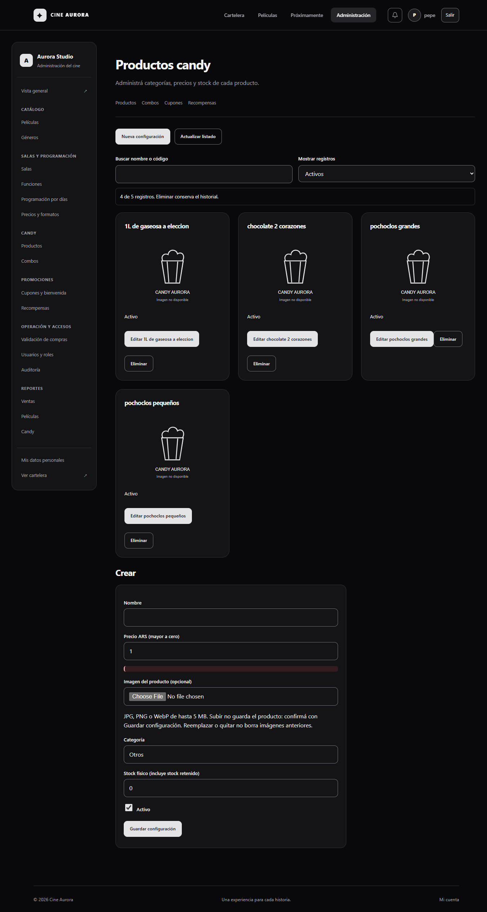

#### Combos

Composición de paquetes de productos con precio propio y entrada opcional.
Permite administrar la oferta conjunta sin perder el control de sus componentes.

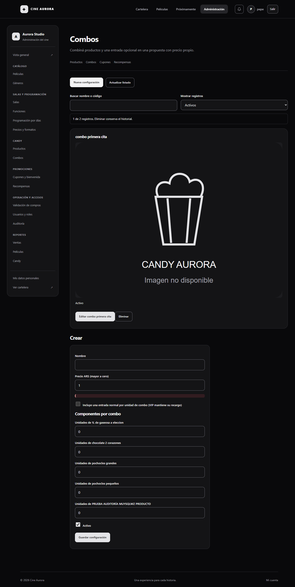

</details>

<details>
<summary><strong>04 · Promociones — cupones, bienvenida y recompensas</strong></summary>

#### Cupones y bienvenida

Configuración de descuentos, vigencia y segmentación: primera compra, usuario,
película, importe mínimo o edad mínima, según el cupón. El porcentaje de
bienvenida se configura desde esta pantalla; PostgreSQL genera el cupón al
crear el perfil y verifica sus condiciones en el checkout.

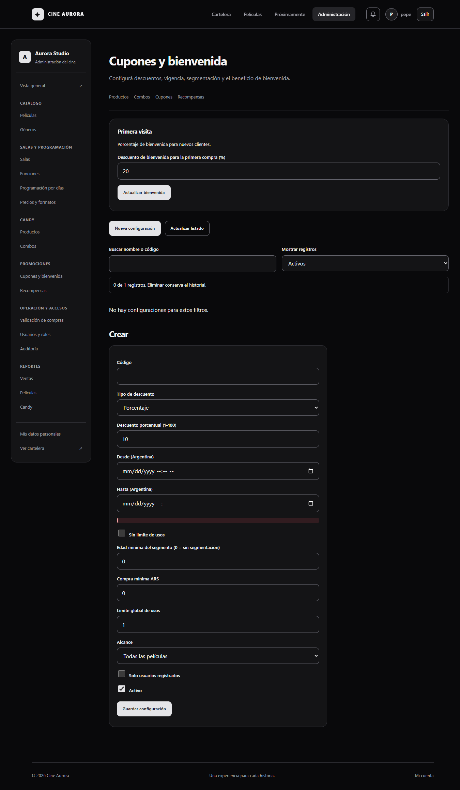

#### Recompensas

Definición de entradas o productos que se canjean por puntos, con estado y costo
de canje. Conecta la administración de promociones con la fidelización del cliente.

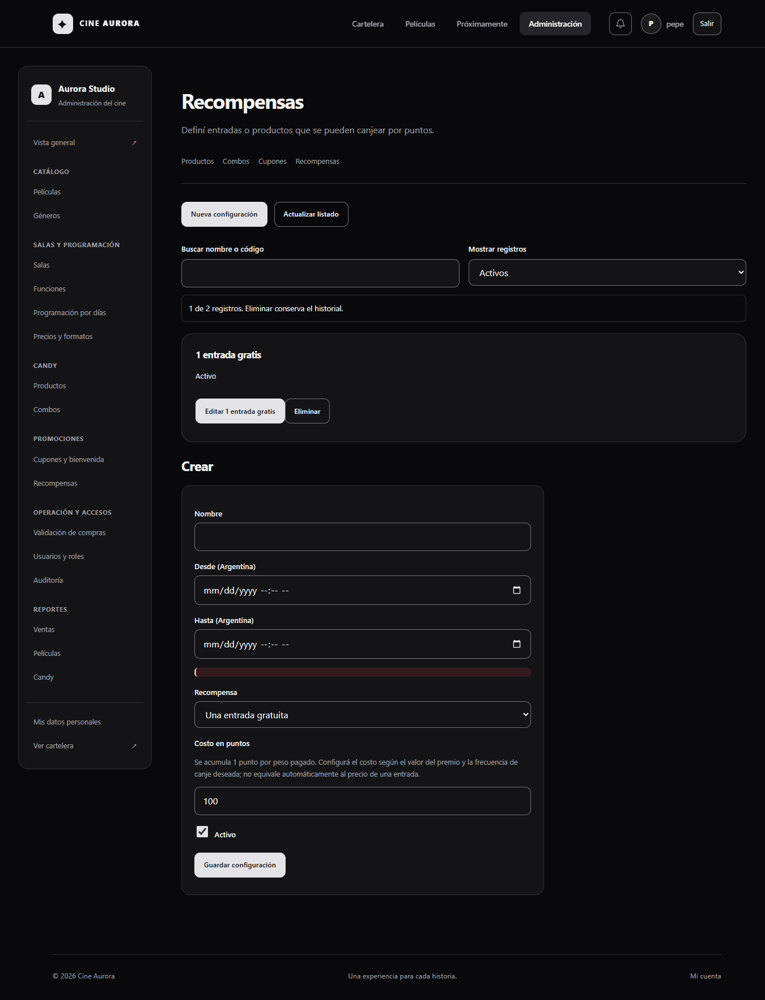

</details>

<details>
<summary><strong>05 · Operación y accesos — QR, usuarios, roles y auditoría</strong></summary>

#### Validación de compras

Selección de función y prestación: ingreso a sala o retiro de candy. Permite
escanear el QR o ingresar el código. No realiza un nuevo cobro: registra el uso
de una compra confirmada y controla el consumo de cada prestación.

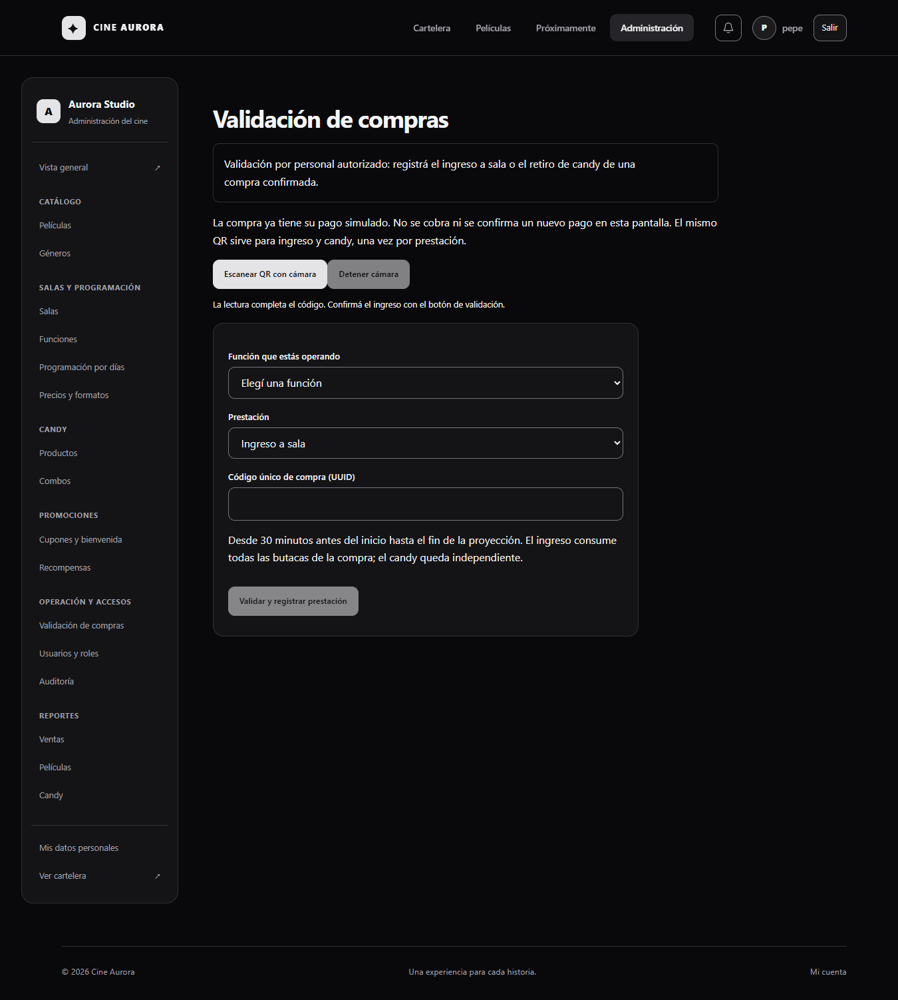

#### Usuarios y roles

Búsqueda de cuentas existentes y gestión de rol/estado con confirmación
explícita. No solicita contraseñas, no elimina cuentas y protege al administrador
contra la pérdida de su propio acceso. **Los datos personales se ocultaron en
la imagen, no se alteraron en la aplicación.**

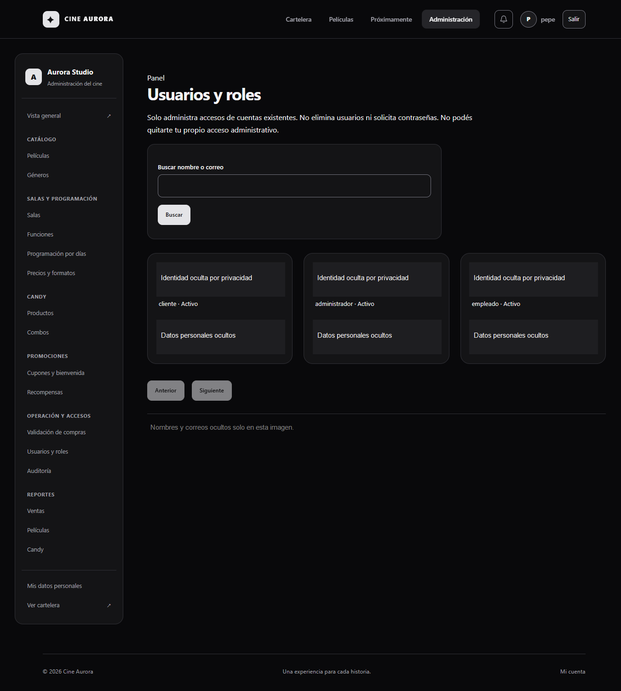

#### Auditoría

Consulta paginada de operaciones del backend por intervalo: qué cambió, quién
lo hizo y cuándo. El visor no expone correos, tokens ni comprobantes PDF.

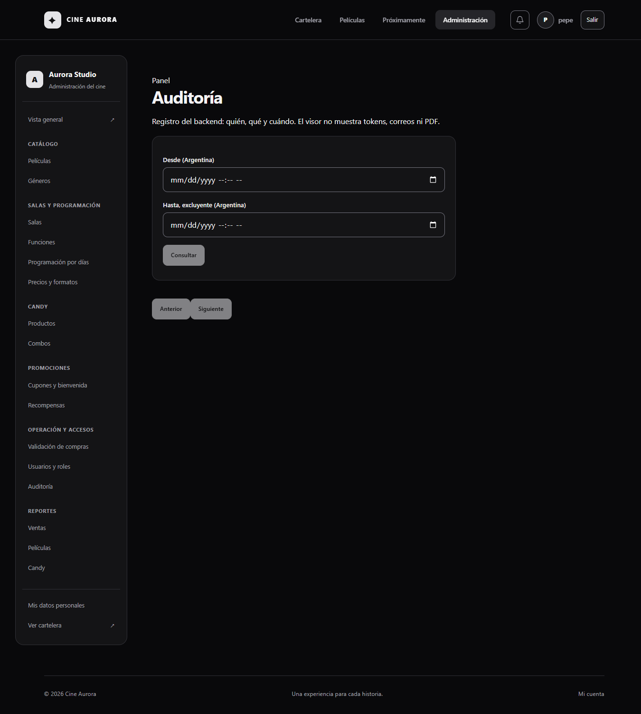

</details>

<details>
<summary><strong>06 · Reportes — ventas, películas y candy con resultados</strong></summary>

Los tres reportes permiten seleccionar un período en hora argentina, consultar
resultados y exportarlos a Excel o PDF. Las capturas muestran una consulta de
**octubre de 2026**, con datos de prueba ya existentes; no se crearon compras
para preparar esta galería. Los totales no representan facturación real.

#### Ventas

Compras confirmadas no canceladas, entradas, total de ventas, crédito aplicado
y monto de pago simulado. Incluye gráfico de entradas por día y detalle tabular.

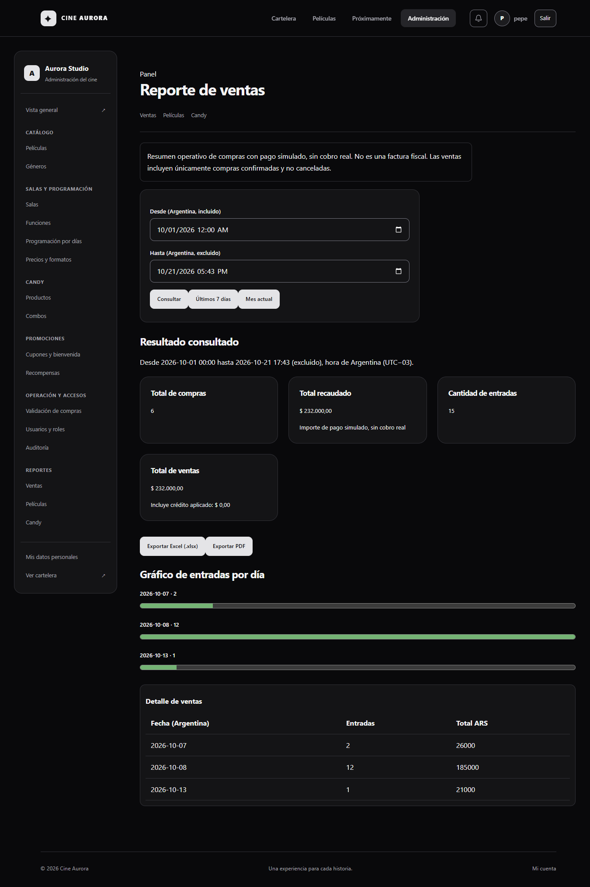

#### Películas

Resultados por película y ranking de ingresos a sala validados. Distingue
entradas compradas de asistencias efectivamente registradas.

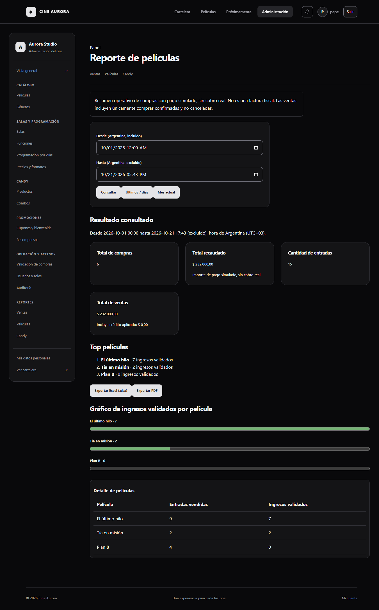

#### Candy

Unidades vendidas, incluidos componentes de combos, ranking de productos,
gráfico y tabla de detalle.

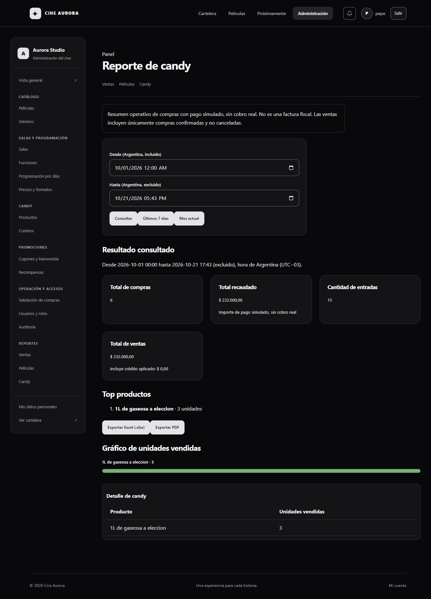

</details>

## Recorrer la demo sin instalar nada

1. Abrí [Cine Aurora](https://cine-aurora.vercel.app) y explorá el ranking de ventas.
2. Entrá a [Películas](https://cine-aurora.vercel.app/peliculas): buscá por título
   o género y probá los filtros de clasificación, idioma y formato.
3. Abrí una película para consultar sinopsis, clasificación, funciones y reseñas.
4. Probá la misma experiencia desde el teléfono para ver la adaptación responsive.

La cartelera se puede consultar sin cuenta. El perfil requiere registro; las
pantallas de empleados y administración requieren un rol autorizado y no se
publican credenciales privilegiadas. La disponibilidad de compra depende de que
haya funciones futuras programadas: al tomar estas capturas, las películas
revisadas no tenían funciones futuras disponibles.

## Capturas de pantalla

La galería está organizada arriba en [experiencia del cliente](#experiencia-del-cliente)
y [backoffice](#backoffice-administración-de-punta-a-punta). Los archivos de
[`docs/capturas/`](docs/capturas/) son páginas completas, no recortes del área
visible. Las vistas públicas corresponden a la demo sin sesión; las protegidas,
a la aplicación local con acceso autorizado. Capturas del **21 de octubre de 2026**.

## Funcionalidades

| Módulo | Qué permite hacer | Valor para el usuario o la operación |
| --- | --- | --- |
| Cartelera y descubrimiento | Buscar películas, filtrar, consultar estrenos y ranking de ventas. | Encontrar una película y conocer su disponibilidad. |
| Butacas y compra | Elegir entre 1 y 8 butacas contiguas; comprar como invitado o usuario registrado. | Recorrer una compra guiada con disponibilidad validada en servidor. |
| Candy y promociones | Agregar productos y combos; aplicar cupones, crédito y beneficios. | Resolver entradas y consumos en un mismo pedido. |
| Comprobante digital | Consultar la compra y obtener PDF y QR. | Tener un comprobante para el ingreso y el retiro de candy. |
| Cuenta y fidelización | Ver compras, películas vistas, puntos, recompensas y escribir reseñas. | Conservar el historial y acceder a beneficios personales. |
| Operación de empleados | Validar entradas y retiro de candy mediante QR, según la función. | Registrar cada prestación y evitar reutilizarla. |
| Administración | Gestionar películas, géneros, salas, mantenimiento de butacas, funciones, precios, ofertas y usuarios. | Centralizar la programación y la operación del cine. |
| Reportes y auditoría | Consultar ventas de entradas, películas y candy, exportaciones y acciones registradas. | Analizar resultados y mantener trazabilidad. |

Las capturas muestran tanto la experiencia pública como el backoffice local
autenticado. Son evidencia visual de las pantallas, no una certificación de
todos los flujos en producción. OAuth y recepción Web Push tienen validaciones
pendientes detalladas en [Estado conocido](#estado-conocido).

### Actores

| Actor | Puede hacer |
| --- | --- |
| Invitado | Consultar cartelera y comprar con un enlace privado; no tiene beneficios ni historial de cuenta. |
| Cliente | Comprar, cancelar dentro de las reglas, consultar historial, reseñar y usar beneficios. |
| Empleado | Validar una entrada o la prestación de candy de una función seleccionada. |
| Administrador | Gestionar catálogo y operación, usuarios, reportes y auditoría. |

## Flujo principal

1. El visitante consulta una película y una función.
2. Selecciona butacas disponibles y, opcionalmente, productos o combos.
3. El checkout vuelve a cotizar y valida edad, stock, modalidad, sala y
   disponibilidad en el servidor.
4. `confirmar-compra` genera el QR y el PDF antes de confirmar el conjunto.
5. PostgreSQL ejecuta la compra como una operación atómica: entradas, stock,
   beneficios, puntos, comprobante y notificación se guardan juntos o se
   rechazan juntos.
6. El QR permite consumir **una** prestación: entrada o candy. El token del
   comprobante es distinto del QR y no se expone en logs.

El carrito del navegador es solo una ayuda visual: no reserva butacas. La
autoridad final siempre es la base de datos, que usa locks, restricciones e
idempotencia para evitar sobreventa y compras duplicadas.

## Arquitectura

### Decisiones técnicas que demuestra el proyecto

| Desafío | Solución implementada | Dónde revisar |
| --- | --- | --- |
| Mantener las butacas actualizadas | Realtime como aviso para volver a consultar; respaldo cada 15 segundos y recarga al reconectar. La selección local se filtra contra la respuesta del servidor. | [`reserva.component.ts`](src/app/features/cine/reserva.component.ts) |
| Evitar que el navegador decida precios o permisos | Cálculo de totales y condiciones de cupones en RPC; autenticación, RLS y validación de rol en backend. Los guards solo controlan la navegación. | [`supabase/migrations/`](supabase/migrations/) |
| Coordinar la confirmación de una compra | Edge Function y operación SQL atómica, con locks e idempotencia para manejar reintentos. | [`confirmar-compra/`](supabase/functions/confirmar-compra/) |
| Evitar reseñas duplicadas desde compras distintas | Clave primaria por usuario y película, con actualización mediante `ON CONFLICT`; se exige una entrada utilizada. | [`Migración de reseña única`](supabase/migrations/20261016000300_resena_unica_pelicula.sql) |
| Incorporar caché sin almacenar información sensible | Service Worker limitado a cartelera pública; sesión, compras, QR y datos personales quedan fuera de la caché. | [`Documentación de arquitectura`](docs/arquitectura.md) |
| Probar reglas además de componentes | Vitest/jsdom para cliente y verificadores SQL con PGlite, sin modificar la base remota. | [`tools/`](tools/) |

### Organización

```text
Angular SPA/PWA
├── core/          Auth, sesión, guards, Supabase, día civil y Web Push
├── data-access/   Servicios, modelos y validación de respuestas
├── features/      Cartelera, compra, perfil, empleados y administración
└── shared/        Componentes, QR/PDF, exportaciones y utilidades

Supabase
├── Auth           Identidad y sesiones
├── PostgreSQL     Datos, RPC, RLS, reglas, locks y auditoría
├── Storage        Afiches y productos públicos
├── Realtime       Eventos públicos para actualizar disponibilidad
└── Edge Functions confirmar-compra y enviar-push
```

Tecnologías principales: Angular 22.2, TypeScript 6, Supabase JS,
PostgreSQL/PLpgSQL, Deno Edge Functions, ZXing, jsPDF, qrcode, Vitest/jsdom y
PGlite. La aplicación usa componentes standalone, lazy loading, signals,
Reactive Forms y Service Worker. En producción el worker cachea únicamente la
cartelera pública; nunca cachea sesión, compras, QR ni datos personales.

## Navegación

- Público: `/`, `/peliculas`, `/proximamente`, `/peliculas/:id`.
- Compra: `/compra/:funcionId/butacas`, `/compra/:funcionId/candy`,
  `/compra/:funcionId/checkout` y `/compra/confirmacion/:compraId`.
- Cuenta: `/perfil`, `/perfil/compras`, `/perfil/peliculas`,
  `/perfil/puntos`, `/perfil/recompensas`, `/perfil/canjes`, `/perfil/credito` y
  `/perfil/notificaciones`.
- Auth: `/auth/login`, `/registro`, `/recuperar-password`,
  `/restablecer-password`, `/confirmacion-email` y `/oauth`.
- Administración: `/admin/**`, con catálogo, programación, candy,
  promociones, accesos, reportes y auditoría.
- Empleados: `/empleados/entrada` y `/empleados/candy`.

`authGuard` protege la cuenta; `rolGuard` protege administración y empleados.
Los guards mejoran la navegación, pero la autorización se verifica nuevamente
en Supabase mediante el rol activo de `perfiles`, nunca mediante metadata del
navegador.

## Reglas de negocio importantes

- Las películas activas se separan automáticamente entre cartelera y
  próximamente usando la fecha civil argentina.
- Una función define sala, idioma, formato y precio. Su fin incluye duración
  más 30 minutos de limpieza; no puede superponerse con otra de la sala.
- Las salas tienen 532 plazas distribuidas en filas accesibles, VIP y normales.
  Las butacas pueden mantenerse bloqueadas por mantenimiento.
- Una compra acepta entre 1 y 8 butacas distintas, consecutivas, de la misma
  fila y bloque. La edad y la clasificación se validan en el servidor.
- Stock, descuentos, crédito y puntos se calculan en PostgreSQL, no en el
  navegador. La compra es un pago simulado.
- Las bajas de catálogo son lógicas y recuperables para conservar historia,
  compras y auditoría.
- Una cuenta puede mantener una reseña vigente por película; el historial de
  reseñas se conserva.

## Instalación local

Requisitos: Node compatible con Angular 22.2, npm y un proyecto Supabase
configurado. El repositorio incluye `package-lock.json`, por lo que se instala
con `npm ci`.

```powershell
Copy-Item .env.example .env.local
# Editar .env.local con SUPABASE_URL y SUPABASE_ANON_KEY
npm ci
npm start
```

Abrir <http://localhost:4200>. Para otro puerto:
`npm start -- --port 4325`. Los scripts `prestart`, `prebuild` y `pretest`
generan automáticamente los archivos ignorados de `src/environments/`.
También puede ejecutarse `npm run env:setup`.

Solo se permiten en el frontend la URL y la clave pública `anon`. Nunca
colocar `service_role`, claves VAPID, secretos de Push ni tokens en `.env.local`,
el código Angular o el repositorio.

### Supabase existente

Las migraciones de `supabase/migrations/` deben aplicarse en orden únicamente
en un proyecto nuevo. En el proyecto remoto de esta entrega hay bloques
aplicados manualmente y no se deben repetir ni ejecutar con `db push` a ciegas.
Antes de modificarlo hay que inspeccionar el esquema, respaldar y aplicar solo
un bloque autorizado. El detalle de compatibilidad y despliegue está en
[`docs/arquitectura.md`](docs/arquitectura.md).

## Pruebas y comandos útiles

```powershell
npm test -- --watch=false
npm run build
npm run verify:documento
npm run verify:admin
npm run verify:integridad
npm run verify:experiencia
npm run verify:catalogo
npm run verify:resena-unica
npm run verify:push
npm run verify:push-worker
npm run verify:cache
npm run verify:estructura
npm run verify:publicacion
```

Los verificadores ejecutan regresiones locales de cliente, SQL/PGlite,
administración, documento, PWA, publicación y Web Push. No sustituyen pruebas
de concurrencia real, recepción Push en un dispositivo ni una auditoría del
proyecto Supabase remoto. Las Edge Functions se pueden comprobar con
`deno check` y `deno test` en `supabase/functions/`.

## Estado conocido

Los flujos centrales, el backoffice y las pruebas locales están implementados.
La demo está publicada y `confirmar-compra` está desplegada. Estas son las
limitaciones y verificaciones pendientes:

- OAuth Google/GitHub tiene código y rutas, pero requiere credenciales y
  configuración del proveedor en Supabase.
- Web Push tiene migración, Edge, Cron y worker; falta comprobar consentimiento
  y recepción real en un dispositivo.
- La baja lógica del catálogo requiere revisar una discrepancia del esquema
  remoto antes de usarla en producción.
- Las pruebas locales no representan varias conexiones concurrentes reales.
- Las plantillas de correo de Auth y algunos procedimientos operativos requieren
  configuración manual.

## Documentación complementaria

- [`docs/arquitectura.md`](docs/arquitectura.md): capas, contratos, datos,
  seguridad, PWA, migraciones, despliegue y pruebas.
- [`docs/requerimientos.md`](docs/requerimientos.md): alcance original,
  requerimientos funcionales/no funcionales y trazabilidad.
- [`docs/reglas-negocio.md`](docs/reglas-negocio.md): reglas, tarifas,
  beneficios, cancelaciones, QR y reportes.
- [`docs/decisiones-tecnicas.md`](docs/decisiones-tecnicas.md): decisiones,
  alternativas y pendientes de diseño.

Este README es la explicación ejecutiva para comprender y ejecutar el
proyecto; `docs/` conserva la especificación y la evidencia técnica detallada.
