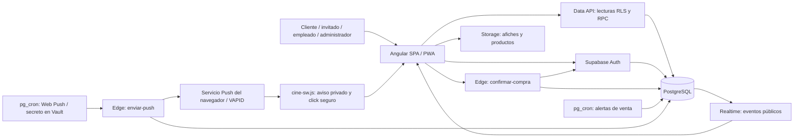
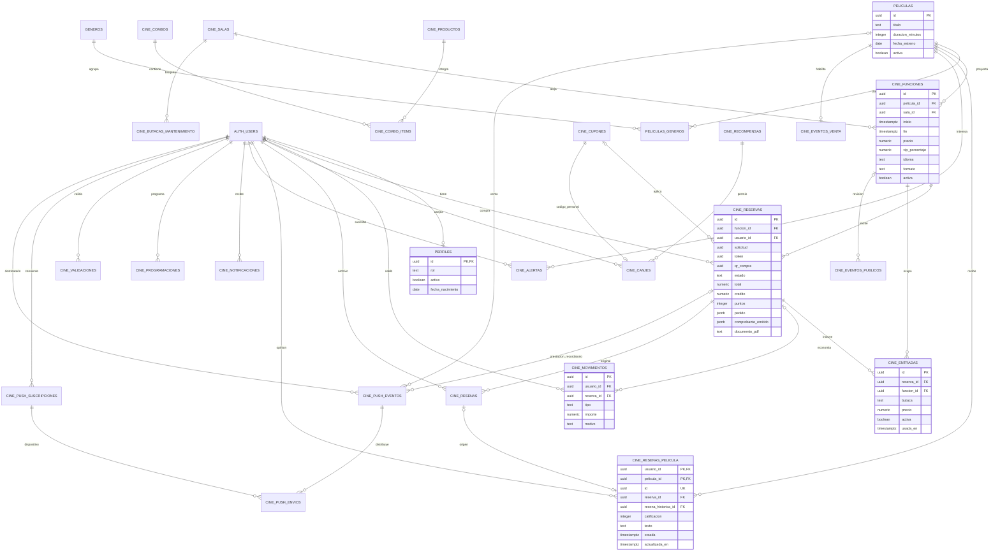
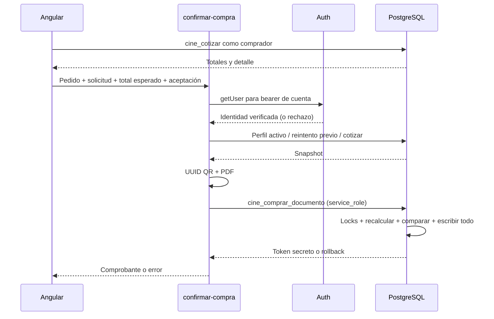

# Arquitectura documentada — Cine Aurora

**Revisión:** 09/10/2026. **Sistema:** aplicación Angular + Supabase + PWA para un único cine con varias salas. **Pago:** simulación, sin cobro real.

Este documento describe la arquitectura, los contratos principales, la operación y sus límites. Se complementa con [requerimientos](requerimientos.md), [decisiones técnicas](decisiones-tecnicas.md) y [reglas del negocio](reglas-negocio.md).

## Índice

1. [Visión y tecnologías](#1-visión-y-tecnologías)
2. [Organización y navegación](#2-organización-y-navegación)
3. [Estado, formularios y presentación](#3-estado-formularios-y-presentación)
4. [Backend y contratos](#4-backend-y-contratos)
5. [Modelo de datos y DER](#5-modelo-de-datos-y-der)
6. [Flujos e integridad](#6-flujos-e-integridad)
7. [Seguridad y privacidad](#7-seguridad-y-privacidad)
8. [Realtime, PWA e imágenes](#8-realtime-pwa-e-imágenes)
9. [Instalación, migraciones y despliegue](#9-instalación-migraciones-y-despliegue)
10. [Pruebas, mantenimiento y pendientes](#10-pruebas-mantenimiento-y-pendientes)

## 1. Visión y tecnologías

La aplicación pública, la cuenta del cliente, la operación del empleado y el backoffice comparten una SPA. No hay un servidor Node/Express propio, aplicaciones nativas ni un proveedor de pagos. Angular consume Auth, Data API/RPC, Storage, Realtime y Edge Functions de Supabase. Frontend HTTPS **https://cine-aurora.vercel.app**; backend Push activado y verificado con lotes vacíos, recepción real en dispositivo pendiente.



| Tecnología                             | Declaración / uso en el repositorio                                                                                          |
| -------------------------------------- | ---------------------------------------------------------------------------------------------------------------------------- |
| Angular 22.2                           | Componentes standalone, router diferido, signals, Signal Forms y Reactive Forms.                                             |
| TypeScript 6.0                         | Tipado estricto; contratos y validación de respuestas desconocidas.                                                          |
| Supabase JS 2.117                      | Cliente de Auth, tablas autorizadas, RPC, Realtime, Storage y Edge.                                                          |
| PostgreSQL / PL/pgSQL                  | Reglas económicas, locks, constraints, RLS, comprobantes e historial. La auditoría histórica remota observó PostgreSQL 17.6. |
| Deno / Edge Functions                  | `confirmar-compra` y `enviar-push`; handlers HTTP independientes de su arranque.                                             |
| web-push 3.6.7 en Edge                 | RFC 8291 aes128gcm y RFC 8292 VAPID, transporte fetch acotado y sin redirects.                                               |
| pdf-lib / qrcode en Edge               | PDF y QR renderizados antes del commit económico.                                                                            |
| jsPDF / qrcode en Angular              | Exportaciones administrativas y compatibilidad de documentos históricos.                                                     |
| ZXing Browser                          | Lectura de QR mediante cámara; alternativa manual.                                                                           |
| Service Worker Angular + worker propio | Assets de producción y SWR exclusivamente de cartelera pública.                                                              |
| Vitest / jsdom                         | Tests Angular; servicios simulados cuando corresponde.                                                                       |
| PGlite                                 | Regresiones SQL locales y variantes del esquema heredado.                                                                    |

Las versiones declaradas y rangos exactos están en `package.json`; `package-lock.json` determina las versiones resueltas. No se debe deducir una versión remota de esos archivos.

## 2. Organización y navegación

### 2.1 Capas y responsabilidades

```text
src/app/
  core/          Auth, sesión, guards, Supabase, conexión, día civil, router y Web Push
  data-access/   Modelos, parsers y servicios de películas, cine y perfiles
  features/      Pantallas públicas, compra, perfil, empleados y administración
  shared/        Componentes reutilizables, reglas visuales, QR/PDF y exportación
src/styles/      Base, tipografía, variables y estilos administrativos
public/          Manifest, iconos, imágenes y cine-sw.js
supabase/
  migrations/    Evolución SQL ordenada; conservar bloques anteriores
   functions/    confirmar-compra, enviar-push y sus tests Deno
  comprobaciones/ Consultas previas de compatibilidad
  templates/auth/ Plantillas Auth preparadas para instalación manual
tools/           Generación del entorno y verificadores locales
```

Dependencia habitual: **pantalla → servicio data-access → Supabase**. `core` encapsula capacidades transversales; `shared` no reemplaza autorización del servidor. No hay NgRx ni repositorio de estado global separado: servicios con signals comparten el estado necesario.

La organización conserva carpetas históricas como `features/cine`; no todos los componentes de un dominio están en una única carpeta. Una ruta/import real es evidencia de uso; el nombre de una carpeta no lo es.

### 2.2 Rutas conectadas

Entrada en `src/main.ts`; configuración en `src/app/app.config.ts`; navegación principal en `src/app/app.routes.ts`. `loadChildren` y `loadComponent` difieren las features.

| Zona           | Rutas principales                                                                       | Control                                                                     |
| -------------- | --------------------------------------------------------------------------------------- | --------------------------------------------------------------------------- |
| Pública        | `/`, `/peliculas`, `/proximamente`, `/peliculas/:id`                                    | Lecturas públicas limitadas.                                                |
| Compra         | `/compra/:funcionId/butacas`, `/compra/:funcionId/candy`, `/compra/:funcionId/checkout` | Invitado permitido; servidor revalida elegibilidad.                         |
| Comprobante    | `/compra/confirmacion/:compraId`                                                        | `compraId` contiene el token portador sensible, no un ID público de compra. |
| Cuenta         | `/perfil`, `/perfil/compras`, `/perfil/compras/:id`, `/perfil/peliculas`                | `authGuard`; SQL comprueba titular.                                         |
| Beneficios     | `/perfil/{puntos,credito,recompensas,canjes,notificaciones}`                            | Cuenta activa; no cacheable.                                                |
| Administración | `/admin/**`                                                                             | `rolGuard('administrador')` en padre e hijos; comprobación SQL.             |
| Empleado       | `/empleados/entrada`, `/empleados/candy`                                                | `rolGuard('empleado')`; SQL también permite administrador en validación.    |
| Auth           | `/auth/login`, registro, confirmación, recuperación, restablecimiento y OAuth           | Supabase Auth y validación del retorno.                                     |
| Errores        | `/errores/no-encontrado`, `/errores/sin-permiso`                                        | Pantallas reales, con rutas de recuperación.                                |

El administrador valida por `/admin/entradas`; su rol no hereda automáticamente el guard de rutas exclusivas de empleado. Los guards mejoran navegación, pero no son una barrera de seguridad de datos.

El backoffice conserva seis áreas definidas en `features/admin/admin-navigation.ts`: **Catálogo**, **Salas y programación**, **Candy**, **Promociones**, **Operación y accesos**, **Reportes**. Sus enlaces incluyen géneros, mantenimiento, programación por rango, precios/modalidades, productos/combos, cupones/recompensas, usuarios/auditoría y reportes.

### 2.3 Mapa de implementación

| Responsabilidad             | Archivos principales, relativos a `src/app/`                                                                                              |
| --------------------------- | ----------------------------------------------------------------------------------------------------------------------------------------- |
| Inicio/ranking              | `features/cartelera/inicio/`; catálogo/detalle en `features/cine/`.                                                                       |
| Fichas/géneros              | `features/cine/admin-peliculas.component.ts`, `features/admin/generos.component.ts`, `data-access/peliculas/`.                            |
| Salas/funciones             | `features/cine/programacion.component.ts`, `features/admin/funcion-admin.component.ts`, `programacion-rango.component.ts`.                |
| Mantenimiento               | `features/admin/salas/editor-butacas/`, `data-access/cine/operaciones.service.ts`.                                                        |
| Compra                      | `features/cine/reserva.component.ts`, `features/compra/`, `data-access/cine/checkout.service.ts`.                                         |
| Prestaciones/comprobante    | `features/cine/entrada.component.ts`, `comprobante.component.ts`, `shared/entradas/`.                                                     |
| Perfil/beneficios/reseña    | `features/perfil/`, `data-access/perfiles/`.                                                                                              |
| Ofertas/imágenes            | `features/admin/ofertas.component.*`, `data-access/cine/ofertas-admin.service.ts`, `imagenes-productos.service.ts`.                       |
| Reportes/usuarios/auditoría | `features/admin/{reportes,usuarios,auditoria}.component.ts`, `data-access/cine/administracion.service.ts`.                                |
| Baja lógica reusable        | `shared/admin/{accion-catalogo,filtro-catalogo}.component.ts`, `data-access/cine/estado-catalogo.ts`.                                     |
| Web Push                    | `core/notificaciones/web-push.service.ts`, `features/perfil/preferencias-push.component.ts`; emisor en `supabase/functions/enviar-push/`. |

## 3. Estado, formularios y presentación

### 3.1 Estado reactivo

- `SesionService` mantiene sesión Auth, perfil, carga y derivados de rol/actividad. Tener JWT no implica perfil autorizado.
- `AuthService` sincroniza perfil fuera del callback del SDK y usa revisiones para descartar respuestas atrasadas. Esto evita bloquear el lock interno de Auth o restaurar una sesión vieja después de logout.
- `Carrito` conserva función, butacas y candy en memoria mientras se navega. **Elegir una butaca no crea una reserva temporal en base.** La disponibilidad vuelve a validarse al cotizar/confirmar.
- Estados locales mediante `signal`; listas, precios/resúmenes y filtros mediante `computed`. Se usan `set`/`update`, no mutación de signals.
- `RutaIdentidadStrategy` reutiliza solo la misma configuración de ruta e identidad de parámetros. Cambios de query mantienen estado; cambiar película/función/compra crea la instancia correspondiente.
- Pantallas críticas bloquean doble envío, limpian saldos/datos inválidos y preservan borradores ante rechazo. Las cargas con revisiones o guardas evitan que una respuesta vieja se imponga a una nueva; no implica cancelación de todas las peticiones de red.

### 3.2 Formularios y validación

Signal Forms en flujos nuevos; Reactive Forms en editores existentes y selección de butacas. `shared/cine/reglas.ts` implementa el custom validator de 1–8 asientos, sin duplicados, misma fila y mismo bloque físico.

La validación del navegador da mensajes/foco oportunos. SQL vuelve a comprobar límites, modalidad, fechas, edad, contigüidad, disponibilidad, stock, cupón y crédito. Los parsers de `data-access/cine/validacion.ts` tratan respuestas como `unknown`, verifican listas/objetos/textos y números finitos; no se confía en un cast para validar JSON.

### 3.3 Fechas y accesibilidad

`DiaCineService` calcula la fecha civil argentina y la actualiza cada minuto con pestaña visible y al recuperar foco/visibilidad. `shared/cine/fecha-argentina.ts` convierte campos administrativos a UTC−03 y conserva instantes históricos completos cuando una vigencia no cambió. `fin` incluye limpieza; no es el fin de proyección.

La identidad visual se mantiene negra/grafito/plata. HTML usa control de flujo nativo, labels, estados `role="status"`/`alert`, foco visible y controles por teclado. Afiches verticales y candy con proporción propia, texto alternativo y fallback; imágenes estáticas con `NgOptimizedImage`. Se usan contenedores desplazables para planos/tablas, sin ocultar controles esenciales.

Los resultados AXE locales son evidencia sobre pantallas/estados probados, **no certificación WCAG completa** ni validación automática de experiencia con lector de pantalla.

## 4. Backend y contratos

### 4.1 Fronteras

El cliente Supabase se encapsula en `core/supabase/supabase.service.ts`. Hay lecturas directas legítimas de perfiles propios, géneros, salas y funciones según RLS. La mayoría de escrituras operativas/económicas van por RPC, no por INSERT/UPDATE desde Angular.

Las funciones privilegiadas usan `SECURITY DEFINER`, `search_path=''`, grants explícitos y verificación de rol/propiedad en el cuerpo. Helpers renombrados `_anterior`, `_base` o `_documento` conservan compatibilidad interna y tienen acceso externo revocado; no son endpoints alternativos que se deban llamar desde Angular.

### 4.2 Inventario de contratos principales

| Contrato                                                                                                                     | Acceso y propósito                                                                                           |
| ---------------------------------------------------------------------------------------------------------------------------- | ------------------------------------------------------------------------------------------------------------ |
| `cine_cartelera()`                                                                                                           | GET público de fichas activas, ventas y pares idioma/formato; único endpoint de datos con SWR.               |
| `cine_catalogo(p_admin)`                                                                                                     | Catálogo; modo administrativo autorizado en SQL, no por el flag solamente.                                   |
| `cine_disponibilidad(funcion)`                                                                                               | Plano, ocupadas, bloqueadas y precios actuales; público, online.                                             |
| `cine_candy_catalogo()`                                                                                                      | Productos/combos activos; stock y componentes.                                                               |
| `cine_cotizar(...)`                                                                                                          | Cotización del comprador actual; no reserva ni confirma. Omite IDs internos de consumo/cupón.                |
| Edge `confirmar-compra`                                                                                                      | POST de pedido, `solicitud`, total esperado y aceptación de simulación; devuelve token del comprobante.      |
| `cine_comprar_documento(...)`                                                                                                | Commit económico; invocable por `service_role` backend, nunca por cliente anon/authenticated.                |
| `cine_detalle_reserva(token)` / `cine_comprobante(token)`                                                                    | Lectura por portador para el invitado; no equivale a consulta privada autorizada por cuenta.                 |
| `cine_mis_reservas()` / `cine_mi_reserva(token)`                                                                             | Compra propia; marcador de reseña única, texto y calificación vigente.                                       |
| `cine_cancelar(token)`                                                                                                       | Compensación de compra propia elegible, idempotente.                                                         |
| `cine_validar_compra(codigo,tipo,funcion)`                                                                                   | Empleado/admin, consume solo prestación seleccionada y registra resultado.                                   |
| `cine_mis_beneficios()`                                                                                                      | Saldos, movimientos, cupones, canjes, alertas y notificaciones; **materializa alertas**, no es lectura pura. |
| `cine_canjear(recompensa,solicitud)`                                                                                         | Débito de puntos y cupón personal en una transacción.                                                        |
| `cine_escribir_resena(...)` / `cine_resenas_publicas(pelicula)`                                                              | Edición propia única por película / opiniones y promedio públicos.                                           |
| `cine_guardar_pelicula`, `cine_guardar_genero`, `cine_guardar_oferta`                                                        | Administración validada con compatibilidad heredada.                                                         |
| `cine_estado_catalogo(tipo,id,activo)`                                                                                       | Baja/restauración de siete tipos; solo cambia estado y efectos de triggers/auditoría.                        |
| `cine_guardar_sala`, `cine_adaptar_sala`, `cine_butacas_admin`, `cine_mantener_butacas`                                      | Plano normativo y mantenimiento protegido.                                                                   |
| `cine_crear_funcion`, `cine_editar_funcion`, `cine_reprogramar_funcion`, `cine_cancelar_funcion`, `cine_programar_funciones` | Programación protegida, lotes atómicos y compensación donde es viable.                                       |
| `cine_reportes_admin`, `cine_consultar_auditoria`, `cine_usuarios_admin`, `cine_administrar_usuario`                         | Reportes, auditoría paginada y gestión de cuentas existentes.                                                |
| `cine_procesar_alertas_venta`                                                                                                | Interno/Cron, materializa apertura efectiva y avisos deduplicados.                                           |
| `cine_push_configuracion`, `cine_push_estado`, `cine_push_suscribir`, `cine_push_desuscribir`                                | Cuenta activa consulta/consiente su dispositivo; baja propia Auth también con perfil desactivado.            |
| `cine_push_tomar_lote`, `cine_push_autorizar_envio`, `cine_push_finalizar`                                                   | Solo backend service_role; claim con lease, revalidación y resultado/reintento.                              |
| Edge `enviar-push`                                                                                                           | Solo scheduler/backend con secreto de despacho; rechaza Origin y no publica CORS.                            |

Las firmas exactas, defaults y revocaciones deben consultarse en la última migración que define cada función, **no solo en el primer archivo donde aparece**.

## 5. Modelo de datos y DER

### 5.1 Entidades y persistencia

| Entidad física                                              | Responsabilidad / restricciones esenciales                                                                         |
| ----------------------------------------------------------- | ------------------------------------------------------------------------------------------------------------------ |
| `auth.users`, `perfiles`                                    | Identidad Auth y perfil/rol/activo separado; perfil asociado al usuario.                                           |
| `peliculas`, `generos`, `peliculas_generos`                 | Catálogo y relación N:M; estado lógico e historial de asociaciones.                                                |
| `cine_salas`, `cine_funciones`                              | Sala adaptada, inicio/fin, precios y modalidad por función.                                                        |
| `cine_butacas_mantenimiento`                                | Estado de mantenimiento por `(sala_id,codigo)`; plano base generado por `cine_butacas`.                            |
| `cine_reservas`                                             | Nombre legado; compras nuevas confirmadas, pedido idempotente, PDF/snapshot y tokens distintos.                    |
| `cine_entradas`                                             | Asiento por compra/función, precio emitido y uso; índice único parcial `(funcion_id,butaca) WHERE activa`.         |
| `cine_productos`, `cine_combos`, `cine_combo_items`         | Categoría/stock/imagen, combo y composición N:M con cantidad.                                                      |
| `cine_cupones`, `cine_configuracion`                        | Condiciones de descuentos/premios y porcentaje de bienvenida.                                                      |
| `cine_recompensas`, `cine_canjes`                           | Premio/costo, cupón emitido y solicitud única de canje.                                                            |
| `cine_movimientos`                                          | Libro de crédito/puntos; saldos derivados por suma, no campo editable arbitrariamente.                             |
| `cine_resenas`                                              | Archivo histórico por compra, protegido contra INSERT/UPDATE/DELETE tras regla nueva.                              |
| `cine_resenas_pelicula`                                     | Opinión vigente: PK `(usuario_id,pelicula_id)` y referencia opcional a original histórica.                         |
| `cine_alertas`, `cine_notificaciones`, `cine_eventos_venta` | Suscripción por película, bandeja con clave deduplicada y primera habilitación efectiva.                           |
| `cine_eventos_publicos`                                     | ID/revisión, sin documentos ni identidad del comprador; única tabla publicada para actualización de la aplicación. |
| `cine_programaciones`                                       | Pedido/lote de funciones e idempotencia administrativa.                                                            |
| `cine_validaciones`, `cine_auditoria`, `eventos_auditoria`  | Resultados de prestaciones y registros de actividad; visor no devuelve snapshots sensibles.                        |
| `cine_push_config`                                          | Singleton deshabilitado inicialmente; origen HTTPS, VAPID pública y URL del emisor, no claves privadas.            |
| `cine_push_suscripciones`                                   | Endpoint único privado, keys del dispositivo, cuenta, consentimiento activo y revisión.                            |
| `cine_push_eventos`, `cine_push_envios`                     | Outbox evento/cuenta único, entrega evento/dispositivo única, vencimiento, lease, intentos y HTTP sin cuerpos.     |

### 5.2 DER físico simplificado



Es un complemento gráfico de las relaciones principales, no un dump de todas las columnas/índices/triggers. Las butacas normativas se generan: no hay una tabla de edición libre de geometría por asiento. Candy/precios/composición del recibo se preservan como JSON de emisión; el catálogo actual no reescribe el PDF histórico.

## 6. Flujos e integridad

### 6.1 Compra atómica



La Edge no mantiene una transacción entre llamadas HTTP. La unidad económica real es una RPC SQL: función, mutex, revalidación de cotización, compra, entradas, stock, crédito, puntos, QR/PDF y notificación. El PDF se prepara antes; no queda una compra sin documento si el renderizado falla. Cambiar precios o agotar stock después de cotizar provoca rechazo completo.

`solicitud` identifica el pedido. Repetirlo con el mismo titular/contenido recupera el comprobante, incluso tras perder la respuesta; reutilizarlo para otro pedido se rechaza. La protección del SDK/UI no sustituye la unicidad/locks del backend.

### 6.2 Locks y concurrencia

La programación toma salas en orden uniforme; según operación se bloquean funciones y mutex económico. Compra toma función + mutex. Mantenimiento y baja protegida coordinan salas/funciones/mutex; cambios de rol y programación por solicitud emplean locks advisory específicos.

El índice parcial de butacas activas agrega protección de unicidad. Las reservas históricas vencidas se excluyen del negocio y sus entradas activas se liberan al confirmar nuevas compras. No se debe quitar el mutex ni sustituir locks por una consulta previa en Angular. Las pruebas SQL locales no simulan conexiones independientes reales.

### 6.3 Otros flujos

- **Validación:** operador selecciona función y prestación; escaneo/manual llama `cine_validar_compra`; un uso exitoso consume ingreso conjunto o candy, nunca ambos. Rechazos de negocio también dejan registro.
- **Cancelación:** titular/plazo/uso se revalidan tras locks; crédito compensatorio, devolución de stock, reversión de puntos e inactivación de entradas se aplican juntos. Repetir no duplica compensación.
- **Programación:** sala automática según intervalos con limpieza; lote por días/rango de hasta 90 días, todo o nada y solicitud idempotente. Reprogramar con compras/reservas vigentes se bloquea para no invalidar documentos.
- **Mantenimiento:** estado de una butaca de la sala hasta restauración explícita; lote rechazado si afecta plazas comprometidas en funciones futuras/en curso.
- **Baja lógica:** filtros Activos/Eliminados recuperables/Todos; servidor cambia solo estado. La UI espera éxito antes de ocultar y conserva el registro ante fallo.
- **Reseña:** todas las compras propias de una película leen la misma opinión; upsert por cuenta/película, un voto en promedio. Archivo original intacto; el editor bloquea escritura si falta el marcador de backend nuevo.
- **Reportes:** `cine_reportes_admin` agrega compras confirmadas no canceladas por período. Ventas cuentan fecha de compra; vistas, fecha de validación. XLSX real OOXML con números y texto `inlineStr`, no fórmulas provenientes de datos; PDF multipágina vía jsPDF.

## 7. Seguridad y privacidad

### 7.1 Identidad y autorización

Supabase Auth verifica credenciales; `perfiles.rol/activo` gobierna capacidades. Metadata de registro aporta datos personales, **nunca autorización administrativa**. Guardas refrescan perfil y SQL verifica rol activo; el commit de compra comprueba de nuevo la cuenta. Logout usa alcance local, no revocación global de todos los dispositivos.

`verify_jwt=false` en `confirmar-compra` permite invitados. Para un bearer de cuenta se ejecuta `getUser`; un JWT inválido no se transforma en invitado. La Edge pasa identidad verificada al RPC privado y no acepta `usuario_id` como autoridad del navegador. `enviar-push` también desactiva el filtro JWT, pero exige su secreto backend y rechaza peticiones con `Origin`: la clave anon o un JWT de cliente no autorizan envíos.

### 7.2 Secretos y enlaces

- Frontend: solo URL y clave pública anon desde variables. Son visibles en la aplicación compilada por diseño.
- Backend: `service_role`, credenciales SMTP/OAuth, clave VAPID privada y secreto de despacho nunca en Angular/Git. Endpoints/keys de dispositivos son privados y no se imprimen en logs/respuestas del emisor.
- `qr_compra` autoriza prestación; `token` autoriza lectura de comprobante. Son diferentes secretos. Un enlace de invitado es acceso por posesión, no por cuenta.
- No incluir QR, bearer links, JWT, PDFs, contacto ni credenciales en logs, métricas, ejemplos reales o capturas.
- CORS limita orígenes de navegador, no autentica ni frena por sí solo clientes externos. El handler acepta peticiones sin `Origin`; falta antiabuso específico del invitado.
- El límite HTTP actual verifica `Content-Length` y longitud del texto tras leerlo; no constituye lectura streaming acotada garantizada antes de cargar el cuerpo.

### 7.3 RLS, grants y hallazgos pendientes

RLS y grants son complementarios: permitir ejecutar una RPC no concede lectura indiscriminada, y una función definer necesita controles internos. Los cierres de catálogo/perfiles revocan también permisos por columna. El lector privado de reseña no agrega comentario propio al contrato de portador.

La auditoría previa observó grants excesivos INSERT/UPDATE/DELETE/**TRUNCATE** de `cine_eventos_publicos`. RLS SELECT-only no protege TRUNCATE. Antes de publicar el usuario autorizó el cierre específico: se aplicó una vez `20261017000200_cierre_eventos_publicos.sql`, incluyendo permisos por columna, y se verificó SELECT conservado/TRUNCATE denegado para anon/authenticated. RLS y triggers permanecieron iguales; no se ejecutaron escrituras de filas. La tabla de revisiones tenía 15 filas antes/después, pero cambió su hash entre lecturas: no se certifica igualdad de valores en una tabla viva. Defaults amplios y snapshots privados de auditoría siguen pendientes de revisión/minimización separada.

No abrir políticas `USING(true)` para silenciar Advisors ni cambiar funciones a invoker indiscriminadamente. No se acredita seguridad total por tener RLS habilitado.

## 8. Realtime, PWA e imágenes

### 8.1 Actualización

`OperacionesService.observar` escucha IDs de `cine_eventos_publicos`, informa estado del canal y elimina suscripciones al destruir. Después de un evento se vuelve a consultar el contrato autorizado; no se transmite la fila privada de compra.

Mapa: polling de respaldo de 15 s con pestaña visible, reconsulta al recuperar red/visibilidad y al reconectar canal. Muestra última consulta y cantidades libres/ocupadas/mantenimiento. Un asiento seleccionado que deja de estar disponible se retira con explicación; la confirmación del servidor sigue siendo la autoridad final.

### 8.2 SWR de cartelera

En producción `app.config.ts` registra `cine-sw.js`, que importa `ngsw-worker.js`. `ngsw-config.json` gestiona assets; `dataGroups` vacío es deliberado.

El worker propio intercepta **solo GET `/rest/v1/rpc/cine_cartelera` en hosts `.supabase.co`**. Clave de caché: origen + ruta, sin JWT. Devuelve una copia válida de menos de siete días y revalida en paralelo; guarda solo respuestas exitosas JSON. Si cambia, avisa a pestañas. Fallos de CacheStorage no descartan una respuesta de red válida. Sin red ni copia reciente responde 503, no inventa datos.

Auth, perfil, saldo, compra, documento, QR, validación y disponibilidad quedan fuera de caché de datos. Operaciones críticas requieren conexión. Un afiche remoto no consultado no está garantizado offline. `ng serve` no verifica instalación/service worker de producción.

### 8.3 Storage y Auth emails

Buckets públicos `afiches-cine` y `productos-cine`, máximo **5 MiB**, JPG/PNG/WebP. Carga de administrador activo en carpeta propia con nombre UUID, sin upsert. Producto guarda ruta controlada, no URL externa arbitraria; backend comprueba objeto en Storage. Firma binaria del cliente mejora UX, no protege por sí sola contra cliente malicioso.

Reemplazo crea objeto nuevo; quitar imagen elimina vínculo, no borra indiscriminadamente objetos. Puede quedar una imagen huérfana si la subida termina y falla el guardado. No alojar PDFs/QR privados en estos buckets públicos.

`supabase/templates/auth/` contiene cinco HTML en español: confirmación, recuperación, magic link, cambio de email e invitación. Conservan `{{ .ConfirmationURL }}`. Instalarlos no habilita nuevos flujos y continúa SMTP **solo Auth**, sin correos de entradas. Activación/entrega real siguen pendientes.

### 8.4 Web Push privado

- **Consentimiento:** pantalla `/perfil/notificaciones`, botón explícito; consultar estado nunca solicita permiso. Solo contexto seguro, Notification/PushManager y worker propio activo. iPhone/iPad requieren PWA instalada compatible. Estado fallido se muestra **No verificado**, no como baja exitosa; la baja local sigue disponible aunque falte el servidor.
- **Dispositivo:** endpoint único, máximo diez activos por cuenta. Reintentar alta misma cuenta/keys es idempotente. Compartir navegador requiere nueva activación explícita; el traspaso con las mismas keys incrementa revisión y descarta entregas anteriores. Otro titular no consulta su estado. Logout intenta baja local primero y remota propia, con espera máxima de cinco segundos; no bloquea salir si falla ni desactiva otros dispositivos.
- **Eventos nuevos:** trigger del aviso `venta:` efectivo; trigger ingreso cuando una entrada pasa a usada (un evento por compra, aunque consuma varios asientos); candy independiente. No reenvía avisos históricos al suscribirse. Invitado o cuenta sin dispositivo activo no generan outbox.
- **Recordatorios:** al reclamar lote se examinan compras confirmadas, función activa, ingreso todavía pendiente y perfil activo. Hora prevista = inicio menos 24 h / 2 h; solo margen `[hora prevista, hora prevista + 15 min)`. Compra posterior a esa hora no recibe recordatorio atrasado. La clave incluye inicio para distinguir reprogramación; cancelación/uso/cambio de función/vencimiento invalidan el envío al revalidar.
- **Cola:** evento/cuenta y entrega/dispositivo únicos; `FOR UPDATE SKIP LOCKED`, lote máximo 20, lease 2 min, cuatro envíos HTTP simultáneos, timeout 10 s y RPC 5 s. Resultado 2xx = aceptado por proveedor (**no comprobante de lectura/recepción**); 404/410 da baja y descarta pendientes. Red/408/429/5xx reintentan con backoff 30 s × 2^(intento−1), Retry-After acotado a 24 h y máximo seis intentos. Otros 4xx fallan sin loop. Vencimiento comercial sigue limitando todo retry.
- **Privacidad:** cifrado aes128gcm y JWT VAPID firmado. Payload solo versión/evento/tag/vencimiento/destino público o cuenta; sin sala, nombre de película privada, contacto, QR, JWT, PDF o enlace portador. Textos fijos en worker, no texto recibido arbitrario. Venta abre `/peliculas/UUID`; los demás `/perfil/compras`, protegida por guard/SQL. Click rechaza rutas/queries/hosts arbitrarios, navega/focaliza ventana del mismo origen o abre una nueva segura.
- **Límites:** allowlist HTTPS FCM/Mozilla/Apple/Windows, sin redirects para evitar SSRF. Worker usa tag de entrega y no repite aviso aún visible. Tras envío aceptado y ack perdido existe posible reentrega: garantía **al menos una vez con deduplicación**, no exactamente una vez ni entrega garantizada del SO. Un envío ya en tránsito puede llegar tras baja; por eso el contenido sigue siendo mínimo. Retención/limpieza de outbox requiere política futura sin borrar claves de deduplicación indiscriminadamente.

RLS habilitada y revocación total de acceso directo, incluido TRUNCATE, para los cuatro objetos Push nuevos; RPC del backend tienen grants exclusivos. Ninguna tabla Push se publica por Realtime ni se cachea. El cierre de la tabla antigua de eventos se instaló por separado; no es revisión total de defaults/privilegios. Backend Push instalado no acredita recepción en dispositivo ni aceptación docente de RF-79/80.

## 9. Instalación, migraciones y despliegue

### 9.1 Desarrollo

```powershell
npm ci
# Copiar .env.example a .env.local y completar URL/anon pública.
npm start
```

URL local habitual `http://localhost:4200`; puerto alternativo `npm start -- --port 4325`. `prestart/pretest/prebuild` ejecutan `tools/configurar-entorno.cjs` y generan `src/environments/environment*.ts`, ignorados por Git. Para comandos Angular directos ejecutar antes `npm run env:setup`. No imprimir ni versionar `.env.local`.

### 9.2 Historial SQL y estado del proyecto existente

**No ejecutar todos los SQL otra vez.** Los pegados manuales en SQL Editor pueden no figurar en el ledger de la CLI. La migración inicial reconstruye un esquema; no es un dump compatible para sobrescribir el remoto existente.

| Bloque / archivo en `supabase/migrations/`                                                                                                | Función y estado conocido                                                                                                  |
| ----------------------------------------------------------------------------------------------------------------------------------------- | -------------------------------------------------------------------------------------------------------------------------- |
| `20261006000100_esquema_inicial.sql`                                                                                                      | Perfiles/catálogo/auditoría base; compatibilidad remota con helpers históricos distintos. No reaplicar.                    |
| `20261007000100_operacion_cine.sql`, `20261007000200_afiches_storage.sql`                                                                 | Operación inicial y bucket afiches.                                                                                        |
| `20261008000100_perfil_historial.sql`, `20261008000200_checkout_beneficios.sql`, `20261008000300_configuracion_cliente.sql`               | Historial/economía y administración base; flujos presenciales luego revocados.                                             |
| `20261009000100_alineacion_documento.sql`                                                                                                 | Pago simulado, commit PDF/QR, plano, edad, premios, precios y eventos.                                                     |
| `20261010000100_administracion_operativa.sql`                                                                                             | Reprogramación/cancelación, lotes, roles, reportes y visor unificado.                                                      |
| `20261011000100_integridad_programacion.sql`, `20261012000100_filtros_modalidad.sql`                                                      | Duración/modalidad protegidas y filtros por pares reales.                                                                  |
| `20261013000100_puntos_por_ocho.sql`                                                                                                      | Cambio histórico a 1/8, posteriormente restaurado. **No repetir ni borrar historia.**                                      |
| `20261014000100_restaurar_puntos_documento.sql`, `20261014000200_cerrar_escrituras_directas.sql`                                          | 1 punto/peso futuro y cierre de bypasses.                                                                                  |
| `20261015000100_mantenimiento_alertas_imagenes.sql`, `20261015000200_productos_storage.sql`, `20261015000300_programar_alertas_venta.sql` | Mantenimiento, imagen candy y Cron cada minuto.                                                                            |
| **Todos los bloques hasta `20261015000300`**                                                                                              | Instalación/objetos revisados en auditoría remota previa. No repetir. No implica prueba de cada escritura.                 |
| `20261016000100_resena_propia.sql`                                                                                                        | Lector anterior por compra; no hace falta instalarlo ahora: incluido/reemplazado por 003. **No aplicarlo después de 003.** |
| `20261016000200_baja_logica_catalogo.sql`                                                                                                 | Antes confirmada por usuario; inspección posterior no encuentra `cine_estado_catalogo`. Discrepancia pendiente, no reaplicar a ciegas. |
| `20261016000300_resena_unica_pelicula.sql`                                                                                                | Instalación confirmada por el usuario; todavía sin auditoría remota independiente ni escritura real designada.             |
| `20261017000100_web_push.sql`                                                                                                             | Ya instalado al comenzar publicación; no se repitió. 14 cuerpos de funciones comparados por hash normalizado y permisos privados inspeccionados. |
| `20261017000200_cierre_eventos_publicos.sql`                                                                                               | Instalado una vez con autorización explícita. Revoca escritura/TRUNCATE/referencias/triggers de API, también por columna; preserva lectura y RLS. |

Proyecto nuevo aislado: comprobar prerrequisitos Supabase (`auth`, `storage`, extensiones) y aplicar migraciones **en orden por nombre**, incluidos bloques intermedios; las regresiones locales no son un ensayo Cloud completo. Proyecto existente: inspeccionar objetos reales, respaldar y aplicar únicamente un nuevo bloque autorizado, completo y transaccional. Ante error detenerse; no desactivar RLS ni continuar por fragmentos. Nunca `db push` indiscriminado sobre pegados manuales.

### 9.3 Edge y frontend público

`confirmar-compra` fue redesplegada durante esta publicación, incluyendo ajuste de ancho de texto del PDF. Se verificó preflight CORS para el dominio público; no se confirmó ninguna compra ni se regeneraron documentos históricos. Para futuras publicaciones autorizadas:

```powershell
npx supabase login
npx supabase secrets set 'CINE_ORIGENES=http://localhost:4200,http://localhost:4325,https://TU-APP.example' --project-ref TU_PROJECT_REF
npx supabase functions deploy confirmar-compra --project-ref TU_PROJECT_REF --no-verify-jwt
npm run build
```

Sustituir placeholders, no ejecutar literalmente. `SUPABASE_URL`, `SUPABASE_ANON_KEY` y `SUPABASE_SERVICE_ROLE_KEY` pertenecen al runtime Edge; el último no pertenece al entorno público Angular. No compartir tokens de login de CLI/Dashboard.

Hosting Vercel: **https://cine-aurora.vercel.app**, proyecto `cine-aurora`, espacio Hobby `plazitas`, Node 24.x. `vercel.json` configura build/salida, rewrite de rutas sin extensión y revalidación de workers; `.vercelignore` excluye secretos/backend/IDE. Se revisaron 239 archivos de la lista de subida: cliente Supabase incluido, `.env` y archivos de entorno generados excluidos. Solo URL/anon públicas en variables del hosting. Publicación por CLI sin GitHub ni commits; no se habilitó un plan pago. HTTP público 200 verificado para SPA, workers, manifest e icono.

Auth: Site URL público y tres retornos exactos `/auth/confirmacion-email`, `/auth/restablecer-password`, `/auth/oauth`, conservando allowlist local previa. No se modificaron otros campos Auth ni se activaron OAuth/plantillas. CORS Edge conserva localhost:4200/4325 y añade dominio HTTPS; la lista se subió mediante archivo de entorno, verificando digest, para evitar alteración de comas por argumentos Windows.

Google/GitHub: código local existente, proveedores observados deshabilitados. El propietario debe configurar sus aplicaciones y credenciales privadas en Supabase. Callback del proveedor: `https://TU_PROJECT_REF.supabase.co/auth/v1/callback`; retorno frontend: `https://TU-APP/auth/oauth`. Son URLs distintas. Configurar Site URL/redirects concretos, sin comodines amplios.

Realtime: publicar solo `cine_eventos_publicos`. Cron `cine-alertas-venta` llama al procesador interno cada minuto; ya observado instalado. **No es scheduler Web Push de 24 h/2 h.**

### 9.4 Activación Web Push — procedimiento y estado

**Estado actual:** backend activado con permiso del usuario. El SQL 001 ya existía y no se repitió. Las claves privadas expuestas en captura fueron retiradas del proyecto y sustituidas antes de haber dispositivos activos; contacto VAPID del titular Vercel, secreto nuevo coincidente Edge/Vault, origen público y job cada minuto. Tres respuestas recientes de Cron/pg_net fueron HTTP 200 sin timeout; emisor directo autorizado devolvió cinco contadores en cero, sin dispositivos ni envíos reales. Sin secreto devuelve 401, con Origin devuelve 403. Acceso directo Vault denegado a anon/authenticated. No repetir los pasos de instalación ya realizados.

**Corrección comprobada en Cloud:** el runtime Edge no aceptaba `base64url` como encoding ECDH aunque Deno local sí; causó arranques fallidos. Se pausó Push, se cambió a decodificación Buffer/base64 y se redesplegó, luego se reactivó. Ahora el transporte también genera un paquete cifrado de autocheck en memoria al arrancar, sin red/logs/dispositivo; detecta incompatibilidad del runtime antes de aceptar tráfico. Los errores iniciales permanecen como evidencia, no se ocultan ni confunden con ejecuciones posteriores correctas.

Los pasos siguientes son referencia para una instalación nueva/aislada o un cambio autorizado, **no para repetir sobre este proyecto**:

1. Acordar URL **HTTPS del frontend** y usuarios/compras/dispositivos de prueba. Respaldar y comprobar bloques anteriores; en proyecto existente ejecutar **solo** el nuevo `supabase/migrations/20261017000100_web_push.sql`, completo una vez. No repetir 002/003 ni instalar de nuevo migraciones antiguas.
2. `npm run push:claves` crea **localmente** `.env.push.local`, ignorado por Git, sin imprimir secretos ni sobrescribir un archivo previo. Guardar copia privada para mantener la identidad VAPID; no regenerar sobre dispositivos activos. Completar `CINE_VAPID_SUBJECT=mailto:CONTACTO-REAL`, `CINE_PUSH_ORIGEN=https://TU-FRONTEND` (sin barra/ruta). No pegar el archivo en chats/logs. La VAPID pública viene de RPC y no requiere cambiar Angular/environment.
3. Con autorización del propietario, instalar secretos y desplegar el emisor (placeholders, no ejecutar literalmente):

   ```powershell
   npx supabase secrets set --env-file .env.push.local --project-ref TU_PROJECT_REF
   npx supabase functions deploy enviar-push --project-ref TU_PROJECT_REF --no-verify-jwt
   ```

   El archivo contiene `CINE_VAPID_PUBLIC_KEY`, `CINE_VAPID_PRIVATE_KEY`, `CINE_VAPID_SUBJECT`, `CINE_PUSH_ORIGEN` y `CINE_PUSH_DISPATCH_SECRET`. `service_role` solo runtime backend. Conservar logs privados y no incluir secretos en parámetros inline/historial de consola.

4. En SQL Editor del propietario configurar **solo valores públicos** (la misma clave pública/origen del emisor):

   ```sql
   select public.cine_push_configurar(
     'https://TU-FRONTEND', 'TU_VAPID_PUBLICA',
     'https://TU_PROJECT_REF.supabase.co/functions/v1/enviar-push');
   ```

5. Crear mediante Dashboard **Vault** un único secreto `cine_push_dispatch_secret` con el mismo valor privado de Edge. No incorporarlo al SQL de una migración ni al texto del job. Después ejecutar manualmente `supabase/comprobaciones/activar-web-push.sql`: invocador privado vía pg_net, job `cine-web-push` cada minuto y lectura del secreto desde Vault. Si existe un job diferente aborta sin reemplazarlo. Verificar permisos de Vault/net y que el secreto no se publique por Data API. Este bloque de instalación no se debe repetir sobre la función ya creada.
6. Publicar nuevo build y worker; abrir la PWA actualizada, consentir desde Notificaciones. En registros designados probar venta, 24 h/2 h, ingreso/candy, baja, click con/sin sesión y dos dispositivos/cuentas. Revisar solo contadores/HTTP/estado y Cron, no endpoint/keys/QR. Verificar mensaje real con app cerrada, TTL y renovación en los navegadores/dispositivos acordados. No usar entradas ajenas para probar.

**Pausa operativa del propietario:** `update public.cine_push_config set habilitado=false where id;` detiene claims e invocación Cron, pero no retira mensajes en tránsito. Para reanudar volver a configurar valores públicos y revisar vigencia; eventos vencidos se descartan. Rotar VAPID exige un plan explícito de baja/resuscripción; la RPC bloquea cambio de clave con dispositivos activos. Cola no es backup y no se promete recepción exacta. En esta activación no se dieron altas de dispositivos, no hubo entrega real ni compras/consumos/reescritura de historial; quedan para registros y consentimiento designados.

## 10. Pruebas, mantenimiento y pendientes

### 10.1 Comandos reproducibles

```powershell
npm test -- --watch=false
npx ngc --noEmit -p tsconfig.app.json
npx tsc --noEmit -p tsconfig.spec.json
npm run verify:documento
npm run verify:resena-unica
 npm run verify:push
 npm run verify:push-worker
npm run verify:publicacion
npm run verify:cache
npm run verify:estructura
npm run build
```

`verify:push` incluye reseña única y todas las regresiones anteriores, además de Push en dos variantes heredadas. `verify:resena-unica` incluye administración, integridad, filtros, puntos, cierre de permisos, mantenimiento, experiencia y baja lógica. `verify:db` valida el esquema previo, no el comportamiento actual completo. PGlite no se conecta al Supabase remoto; adaptaciones locales de Storage/Cron/pg_net/Vault son simulaciones estructurales.

```powershell
npx --yes deno check --no-config --no-lock --node-modules-dir=none supabase/functions/confirmar-compra/index.ts
npx --yes deno test --allow-env --no-config --no-lock --node-modules-dir=none supabase/functions/confirmar-compra/handler_test.ts supabase/functions/confirmar-compra/handler_adversarial_test.ts
 npx --yes deno check --no-config --no-lock --node-modules-dir=none supabase/functions/enviar-push/index.ts
 npx --yes deno test --allow-env --no-config --no-lock --node-modules-dir=none supabase/functions/enviar-push/handler_test.ts supabase/functions/enviar-push/transport_test.ts
```

Los tests Deno usan backend/HTTP simulados; `--allow-env` no equivale a autorizar red o una compra real.

### 10.2 Evidencia y límites

Cierre documental anterior: 352 tests Angular/43 archivos y bundle 528,21 kB. Con Web Push: **390 tests Angular/45 archivos**, tipado estricto de aplicación/tests y build aprobados, bundle inicial **534,53 kB**; siguen warnings de presupuesto 500 kB y CommonJS. La inspección estructural de `src` registra **182 archivos/46 directorios**, 137 conectados a producción y 45 archivos de tests, sin archivos desconectados ni referencias inexistentes.

Se retiraron diez scaffolds desconectados y no se recrearon. Quedan tres carpetas vacías históricas: `data-access/notificaciones`, `features/cartelera/boton-alerta-estreno`, `features/perfil/mis-notificaciones`. Bandeja real: `BeneficiosComponent`/`BeneficiosService`; preferencias Push: nuevo componente enfocado en consentimiento, no otro módulo de bandeja.

Web Push: **40 escenarios SQL por variante (80 ejecuciones)**, **32 escenarios del worker** y **59 tests Deno Push**, más **22 tests Edge de compra** reejecutados (81 Deno). Cifrado RFC 8291 y firma VAPID RFC 8292 comprobados con WebCrypto independiente; mocks HTTP/DB/dispositivo diferenciados de verificación remota §9.4. Regresión de publicación: 20 controles de grants/columnas, filas/RLS/lectura/backend y 12 rutas/assets. Leases/carreras no equivalen a concurrencia PostgreSQL multiconexión. Los 20 escenarios de caché vuelven a pasar, sin ampliar caché privado.

Interfaz Push en build real local: **48 combinaciones Chrome/Edge** (8 estados × 3 anchos 1440/390/320 × 2 navegadores), sin violaciones AXE detectadas, overflow ni errores JS. Incluye servidor deshabilitado, consentimiento/denegación, alta/baja, recarga idempotente, rechazo con rollback y navegador incompatible. Auth/RPC/PushManager están simulados y la red externa está bloqueada: no prueba permiso/recepción del sistema operativo, instalación real ni WCAG integral.

Evidencia previa de navegador: cierre nocturno 510 combinaciones, baja lógica 294 y reseña única 66, Chrome/Edge y Auth/RPC simulados en sus bloques respectivos. No sumar como cantidad de casos distintos ni convertir en certificación Firefox/Safari/WCAG/producción. XLSX de tres reportes abiertos previamente en Excel solo lectura. Auditoría remota previa: definiciones/roles/27 tablas RLS, conciliación de un período y 20 ejecuciones Cron; no escrituras ni carga concurrente.

La revisión comprueba además cuatro archivos exactos, 50 enlaces/anclas, referencias a rutas existentes, 85 RF/14 RNF/17 RN sin duplicados, las 85 prioridades contra el Word y los 33 respaldos SHA256. No modifica código funcional, migraciones, datos ni configuración remota.

### 10.3 Procedimientos operativos mínimos

1. **PWA:** build publicado, cargar catálogo online, esperar control del worker, recargar offline, comprobar solo catálogo/asset cacheado, volver online y verificar actualización. No limpiar almacenamiento de sesiones ajenas.
2. **Conciliación:** comparar compras/entradas/neto/crédito con agregados SQL independientes de un mismo rango; distinguir venta de vista validada y abrir exportaciones. Datos actuales de un período no cubren todos los descuentos/cancelaciones.
3. **Recuperación:** respaldo de esquema/datos y objetos Storage por separado, destino privado y ensayo en entorno aislado autorizado. SQL de migraciones no es backup de compras. No hay restauración de desastre acreditada.
4. **Incidentes:** preservar pedido/solicitud sin publicar secretos; no repetir con otra solicitud una compra cuya respuesta se perdió. Recargar/comprobar antes de consumir otra vez una prestación o repetir un canje confirmado.
5. **Prueba remota:** acordar usuarios/registros/efectos permitidos. No consumir entradas reales ni alterar stock/saldo/roles históricos para fabricar un test.

### 10.4 Pendientes priorizados

- Cierre específico de eventos públicos ya instalado/verificado; revisar defaults, auditoría mínima, backups/restauración y antiabuso invitado.
- Verificación independiente de baja lógica/reseña única y recorridos reales designados de mantenimiento, imágenes, alertas, beneficios, QR/cancelación y multiconexión.
- Frontend HTTPS/Auth URLs y Edge PDF ya publicados; faltan OAuth operativo, plantillas/entrega, instalación PWA en dispositivos y Firefox/Safari.
- **Web Push backend activo**: alta consentida y recepción real de eventos designados, renovación/baja y click con/sin sesión; backend vacío HTTP 200 no acredita entrega.
- Discrepancia de baja lógica: RPC `cine_estado_catalogo` ausente en inspección remota aunque antes se confirmó instalación. Investigar sin reaplicar migraciones previas automáticamente.
- Aceptación docente del alcance fijo+mantenimiento RF-15 y de aviso privado que abre cuenta frente a QR en push RF-79/80.
- Paginación de catálogos/agregados, índices según planes de consultas, observabilidad sin secretos y optimización del bundle. Filtros actuales descargan catálogo completo.
